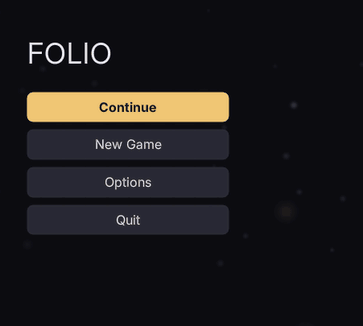

# Components, themes and recipes

One linked file gives a document a navigable component library and a default theme, and the recipes are complete screens to copy.


They live in three places:

| | |
|---|---|
| `/folio/lib/*.rcss` | **Structure.** Sizes, spacing, flex bases, scrollbar geometry, `tab-index` and `nav`. **No colour, anywhere.** |
| `/folio/themes/default.rcss` | **The tokens, and a skin for every library class.** Every colour lives here. |
| your game's stylesheet | Anything it disagrees with, and anything naming the game. |

Load them in that order. A game's rules land last and win by being later, which is how the shipped theme is overridden: a colour inside a component rule could only be overridden by restating the rule in full.

## Getting the library

**A template's head is merged into any document that links it**, and the library is a template:

```html
<link type="text/template" href="/folio/lib/lib.rml"/>
```

One line, the whole library. The document does not need to *use* the template; linking it merges the head.

Order: template heads merge first, then the document's own head, so a document's `<style>` block always wins over the library. Within the library, later `<link>`s win at equal specificity.

## Components

Ten components on a shared `base`, each structure-only:

`panel` · `button` · `menu` · `list` · `slider` · `prompt` · `toggle` (checkbox, radio, segmented) · `tabbar` · `modal` · `motes`

`motes` is a drifting particle field for a menu background, with no interaction. See **[drifting motes](motes.md)**.

Compose these rather than starting from a bare `div`. They get the `box-sizing`, the flex bases and the scrollbar geometry right (each a documented trap in **[layout](layout.md)**), and carry their own `tab-index: auto` and `nav`.

The recipes are written in the token classes from `themes/default.rcss` (`.focusable` is in `lib/base.rcss`):

| | |
|---|---|
| `.t-title` `.t-caption` `.t-numeric` | type scale |
| `.c-text` `.c-muted` `.c-dim` `.c-accent` `.c-danger` | colour |
| `.s-pad-*` `.s-gap-*` `.s-mb-*` | spacing |
| `.x-row` `.x-col` `.x-fill` | layout shorthands |
| `.focusable` | the focus ring, and the `tab-index` that makes it real |

## Recipes

`/folio/rcss/recipes/` holds complete, working screens: a main menu, a pause menu, a confirmation dialog, a controls screen, dialogue, input prompts, a nameplate, a stamina wheel, subtitles, and round shapes (`circle.rml`). **Copy them into your own `UI/`; don't link them.** A linked recipe is a dependency you cannot change. Nothing in a recipe names Folio's directory except the library link.

**A recipe that binds a model needs a mock beside it.** `nameplate.rml` reads `Name` and `Health`, and previews against `UI/mock/nameplate.json` in the plugin. Copy it into your own `UI/mock/` along with the document, or the preview reports the binding as a missing variable.

Every recipe passes `--strict` and `--a11y` with no findings, and `./scripts/check_recipes.sh` keeps it that way.

## Themes

A theme is `@media (theme: name)` in a stylesheet:

```css
@media (theme: high-contrast)
{
	.focusable:focus-visible { border-width: 3dp; border-color: #ffffff; }
	.is-disabled             { color: #9a9aa8; opacity: 1; }
}
```

Turn it on with `folio.Theme <name>`, **Set Theme** from Blueprint, or `uipreview --theme <name>`.

**Several themes can be on at once.** They are independent switches, so `colour-blind` and `large-text` compose without either knowing about the other.

**A theme is global, not per document.** RmlUi tracks it per context, so Folio walks every context when one changes and remembers it for contexts created later.

`high-contrast` ships in the default theme. It widens the focus ring as well as brightening it, and stops disabled controls relying on opacity alone.

## Overriding the shipped look

Your stylesheet loads last, so a plain restatement wins:

```css
/* UI/theme.rcss - loaded after the plugin's default */
.btn         { background-color: #2a1f14; border-color: #6b4a25; }
.btn:hover   { background-color: #3a2a1c; }
.c-accent    { color: #d9a441; }
```

**Keep the token classes and retune them** rather than inventing your own. Every component and recipe is written against `.c-accent` and `.s-pad-m`, so retuning those recolours the whole library.

### Custom properties in your own stylesheets

`--name: value` and `var(--name, fallback)` work as in CSS: declared on any rule, inherited by everything inside, and resolved per element, so a class on a container retints all of it.

```css
body           { --accent: #4fa3ff; --gap: 8dp; }
.faction-red   { --accent: #ff5a4a; }
.title         { color: var(--accent); }
.row           { margin-bottom: var(--gap); width: calc(100% - 2 * var(--gap)); }
.badge         { border: 2dp var(--edge, #ffffff40); }
```

The shipped library and theme do not use them: retune the token classes. A `var()` with no value and no fallback leaves the property at its inherited or initial value. Transitions do not animate a value that comes from `var()`.

**Re-run `--a11y` after retuning colours.** The shipped theme passes contrast on every surface it puts text on; your palette has not been checked. `./scripts/check_a11y.sh UI/` does the sweep.

## Templates for markup

Templates also carry markup, so a shared chrome (a screen frame, a header bar) is written once:

```html
<template name="screen" content="content">
<head>
	<link type="text/rcss" href="/UI/theme.rcss"/>
</head>
<body class="screen">
	<div class="topbar">…</div>
	<div id="content"/>
</body>
</template>
```

A document naming that template has its own body substituted into `content`.

## Fragments in their own files

A panel that belongs to one thing in the game (a held weapon, a possessed vehicle) can live in its own file and be placed into the HUD where it goes. Write it as a template, styles and all:

```html
<!-- UI/held/rifle.rml -->
<template name="rifle">
<head>
	<link type="text/rcss" href="rifle.rcss"/>
</head>
<body>
	<div class="ammo">{{ rifle.ammo }}</div>
</body>
</template>
```

Link it in the HUD's head, then put `<template src>` where its markup goes. Wrap it in a `data-if` so it shows only while it applies:

```html
<head>
	<link type="text/template" href="held/rifle.rml"/>
</head>
<body data-model="hud">
	<div class="held" data-if="held == 'rifle'"><template src="rifle"/></div>
</body>
```

The fragment's body is parsed in place: it reads the HUD's data model, and `data-for` and `data-if` work inside it. Its head merges into the HUD's, so its stylesheet applies to the whole document.

In the game, the object sets `held` on the HUD's view model when it is picked up or possessed, and clears it when released. Don't bind a model per object from the object: `BindViewModel` on a document that is already up rebuilds it.

If the fragment does not appear:

- **`Failed to find template 'rifle'`** in the log: the head has no `<link type="text/template">` for it, or the `name` in the fragment differs from the `src`.
- **The wrong fragment appears**: two templates share a name. Names are global across every document, and the last one loaded wins without a warning. Name each after its file.

Never write an angle-bracketed `head`, `body` or `template` tag inside a comment in a template file. The loader finds those three by raw text search before XML parsing, so a mention inside a comment truncates the file at the wrong place.

## Where to go next

- **[Layout and panels](layout.md)**: what the components are solving for you.
- **[Accessibility](accessibility.md)**: the guarantee the default theme gives, and how to keep it.
- **[Localisation](localization.md)**: `data-loc` on everything the player reads.
- **[UI_CONVENTIONS.md](../UI_CONVENTIONS.md)** §10 and §13: composition and themes in full.
