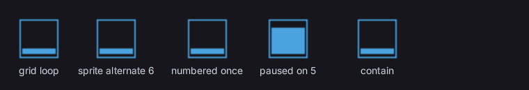

# Flipbooks

`<flipbook>` plays an image's frames in sequence: a coin spinning, a loading glyph, a character walking. It plays on its own, or the game pauses it, seeks it and picks its frame through data binding.



## Play a sheet

A grid sheet, frames left to right then top to bottom:

```html
<flipbook src="/UI/art/coin.png" columns="8" rows="2" fps="12"/>
```

Numbered sprites from an `@spritesheet` (`spin_0`, `spin_1`, ... until a number is missing):

```html
<flipbook sprites="spin_" fps="24"/>
```

A grid inside one sprite of an atlas, so the flipbook shares the atlas texture:

```html
<flipbook sprite="coin_strip" columns="8" fps="12"/>
```

It sizes like an ``: one frame at its natural size. Set `width` and `height` to change that, and `image-color` to tint it.

## Drive it from the game

Every attribute is bindable with `data-attr-*`:

```html
<flipbook src="/UI/art/hero.png" columns="8" rows="4"
	data-attr-fps="Hero.Fps"
	data-attr-paused="Hero.Paused"
	data-attr-frame="Hero.Frame"/>
```

- **Pause**: `paused` (present, `true` or `1`). Removing it or setting `false` or `0` plays on from the same frame.
- **Seek**: setting `frame` jumps there. Playing, it carries on from that frame; paused, it holds it.
- **Pick every frame yourself**: keep `paused` set and bind `frame`.
- **Swap animations**: bind `src` or `sprite`, `columns`, `rows` and `frames` to the clip. Or keep one element per clip and switch with `data-if`; each keeps its own place.
- **Know when it ends**: a `mode="once"` flipbook raises `flipbookend` on its last frame. Catch it with `data-event-flipbookend`.

From C++, cast the element to `Folio::FElementFlipbook` for `Play()`, `Pause()`, `Seek(Frame)`, `GetFrame()` and `GetFrameCount()`.

## Troubleshooting

- **Nothing draws:** the log names the cause. `Could not find sprite '...' specified in flipbook` is a misspelt sprite, or a stylesheet that does not declare it. `[W-ASSET-MISSINGFILE] could not open '...'` is a wrong `src` path.
- **The frames are cut in the wrong places:** `columns` and `rows` do not match the sheet. Every cell has to be the same size, with no padding between them.
- **It shows the end of a row of blank cells:** the last row is not full. Set `frames` to the real count.
- **It does not move with reduced motion on:** by design. It shows `still` (default frame 0), or the bound `frame`. Make a looping flipbook's first frame one that reads well alone.
- **`sprites` stops early:** the numbering has a gap, or a later sprite is on a different spritesheet. The log names the sprite it stopped at.

## Attributes

| Attribute | Default | |
|---|---|---|
| `src` | | An image file, cut into a grid. |
| `sprite` | | A sprite, cut into a grid. Takes precedence over `src`. |
| `sprites` | | A sprite name prefix, numbered from 0. Takes precedence over both. |
| `columns`, `rows` | `1` | The grid. |
| `frames` | `columns` × `rows` | Fewer frames than cells, for a part-filled last row. |
| `fps` | `12` | Frames per second. Changing it keeps the current frame. |
| `mode` | `loop` | `loop`, `once` (stops on the last frame) or `alternate` (forwards then back). |
| `paused` | | Present to hold the current frame. |
| `frame` | | Jumps to this frame (from 0). |
| `fit` | `fill` | How a frame fills a box of another shape: `fill`, `contain`, `cover` or `none`. Centred. |
| `still` | `0` | The frame shown under reduced motion when `frame` is not set. |

A playing flipbook wakes its document once per frame, not every frame, so a 12 fps flipbook costs 12 updates a second. Paused, or finished playing once, it costs nothing.

In [Folio Studio](studio.md), the Timeline scrubs flipbooks with everything else. `uipreview --filmstrip` captures them frame by frame.

## Next

- **[A sprite that copies the player](tutorials/sprite_hud.md)**: a character on the HUD whose clip follows the player's movement.
