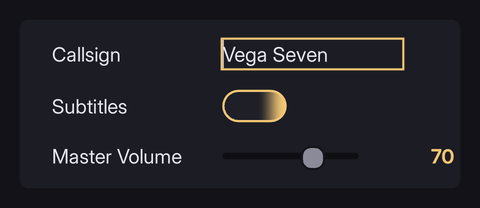

# Form controls

Text fields, checkboxes, radios, selects, progress bars and tabsets with real behaviour, and a `<button>` that clicks.


## Making `<button>` a button

RML is not HTML. Only these tags are backed by real element types with behaviour:

`body` · `img` · `handle` · `form` `input` `select` `textarea` `label` · `progress` / `progressbar` · `tabset`

**Every other tag is a generic element.** `div`, `p`, `h1`, `span`, `button`, `ul`, `li`, `section`, `nav` and anything you invent all instance the same class and differ only in what the stylesheet says.

A `<menuitem>` tag is as real as a `<div>`, but **`<button>` is not a button.** It has no focus behaviour and no click handling until it gets `tab-index: auto`:

```css
button { tab-index: auto; nav: auto; }
```

With that, Enter, Space and the gamepad confirm button all synthesise a click. Tag names are matched literally in selectors, so keep the invented ones documented.

## Text input

```html
<input type="text" id="operator" maxlength="24"/>
<input type="password" id="access" maxlength="16"/>
<textarea id="notes" rows="4"></textarea>
```

Caret, selection, editing and clipboard come from RmlUi. A field on a monitor in the world behaves exactly like one in a menu.

```css
input.field {
	tab-index: auto;
	caret-color: #4ea1ff;
}

input.field:focus-visible { border-color: #4ea1ff; }
input.field selection     { background-color: #4ea1ff4d; }
```

`selection` is a real child element; there is no `::selection`.

**While a field has focus, letters are letters.** Folio's WASD and IJKL navigation schemes stand down automatically.

## Checkboxes and radios

```html
<input type="checkbox" class="toggle" id="vsync" checked/>
<label for="vsync">VSync</label>

<div class="segment">
	<input type="radio" name="channel" id="ch_a" checked/>
	<span>Alpha</span>
</div>
```

Radios sharing a `name` are exclusive.

`:disabled` is set on **any** element with the `disabled` attribute. The attribute also writes `focus: none` onto the element as an inline property, so it leaves navigation and user clicks do not reach it. Bind it with `data-attrif-disabled="expr"`, which adds and removes the attribute; `data-attr-disabled` writes the value as text, and an attribute reading `false` is still there and still disables. The `.is-disabled` class means the same in the component library, for markup that would rather carry a class.

### Styling the box itself

Fill the container with an invisible input and put the appearance on a sibling:

```css
.segment input {
	position: absolute; left: 0; top: 0; width: 100%; height: 100%;
	opacity: 0;
	tab-index: auto;
}

.segment input:checked ~ span       { background-color: #273040; }
.segment input:focus-visible ~ span { border-color: #4ea1ff; }
```

The input keeps the focus, the checked state and the click target; the span carries every pixel. That sibling combinator is also what makes the control count as *named* for the accessibility check; see **[accessibility](accessibility.md)**.

## Select

```html
<select id="quality">
	<option value="low">Low</option>
	<option value="high" selected>High</option>
</select>
```

RmlUi builds the popup itself. It is the least stylable control here; for a settings screen a segmented control is fully yours.

## Progress bars

```html
<progress value="0.6" max="1" direction="right"/>
```

`direction` takes `top`, `right`, `bottom`, `left`, `clockwise`, `counter-clockwise`: the last two are how a radial meter is built without any art. Plus `start-edge`, and the `fill-image` property for a textured fill.

For anything driven every frame, two divs and a width are cheaper and easier to theme. Use `progress` for a radial.

## Tabsets

```html
<tabset>
	<tabs>
		<tab>Video</tab>
		<tab>Audio</tab>
	</tabs>
	<panels>
		<panel>…</panel>
		<panel>…</panel>
	</panels>
</tabset>
```

It sets `:selected` on the active tab and its panel, and `display: none` on the others, as inline properties.

**A tabset silently grows a second, empty `tabs` and `panels` pair.** It creates either child on demand whenever it looks for one and does not find it, and during parsing it looks *before* the markup's own children are in place, so a tabset that declares both ends up with four children: the real pair, then an empty pair appended after them.

It always takes the first match, so everything works. But a bare `tabs` or `panels` tag selector styles two elements, and any border or background is drawn a second time at the bottom of the tabset, which looks like a layout bug in the panel.

**Always write `tabs:first-of-type` and `panels:first-of-type`.**

```css
tabset > tabs:first-of-type   { display: flex; }
tabset > panels:first-of-type { flex: 1 1 auto; }
```

### Switching tabs

A click on a tab switches to it, and so does confirm on a focused one, since confirm synthesises a click. Give each `<tab>` `tab-index: auto` (the library's `.tab focusable` does) or confirm has nothing to land on.

**The shoulder buttons do not switch tabs.** `NextTab` and `PreviousTab` are Tab and Shift+Tab: they move focus through the tab order, the same as on a keyboard. LB/RB cycling a tabset from anywhere on the screen is the game's to wire: catch the action and call `SetActiveTab`.

From C++:

```cpp
auto* Tabs = rmlui_dynamic_cast<Rml::ElementTabSet*>(Document->GetElementById("settings-tabs"));
Tabs->SetActiveTab((Tabs->GetActiveTab() + 1) % Tabs->GetNumTabs());
```

Every change, from a click or `SetActiveTab`, raises `tabchange` on the tabset with the new index as `tab_index`. Save the last tab or play a sound there:

```html
<tabset id="settings-tabs" data-event-tabchange="TabChanged(ev.tab_index)">
```

Every panel is in the document from load and the hidden ones are only `display: none`, so their bindings stay live.

### The library tab bar

`/folio/lib/tabbar.rcss` styles a tabset with `class="tabs"`, its tabs with `class="tab focusable"` and its panels with `class="tab-panel"`. Two extras:

| | |
|---|---|
| `.tab-badge` | a dot inside a tab for unseen or unsaved content |
| `.tab-shoulder` | a row beside the bar for the LB/RB hint icons; put `` in it |

## Forms

`<form>` groups controls and `input type="submit"` raises a submit event, but there is nothing to submit to: no network, no navigation. Listen for the event in C++ or bind it to a data model.

Most screens do not want a form: a settings panel writes each control's value as it changes with `data-value` and `data-checked`. See **[data binding](data_binding.md)**.

## Where to go next

- **[Input and navigation](input_and_navigation.md)**: focus, `nav`, and the disabled recipe.
- **[Components, themes and recipes](components_and_themes.md)**: the library already styles all of these.
- **[UI_CONVENTIONS.md](../UI_CONVENTIONS.md)** §11: the element vocabulary in full.
