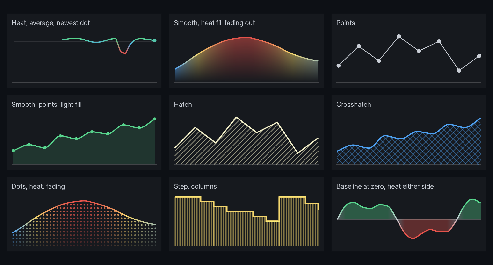

# Line graphs

`<line-graph>` draws a line through a series of values: coloured per point, straight, smooth or stepped, with optional points, an average line and a solid or patterned fill. It is geometry, not elements, so a graph of any length costs one draw.



```html
<line-graph data-attr-values="g.Values" data-attr-tones="g.Tones" data-attr-average="g.Average" data-attr-length="60"></line-graph>
```

```css
line-graph { display: block; height: 40dp; }
```

Give it a size: it has no intrinsic one. Every graph above is in `examples/line_graph_styles.rml`, with its data in `UI/mock/line_graph_styles.json`. For a walkthrough from a mock file to game code, see **[A weapon falloff graph](tutorials/weapon_falloff.md)**.

## Attributes

| | |
|---|---|
| `values` | One string of numbers, oldest first, separated by spaces or commas. Not a JSON array. |
| `min`, `max` | The range `values`, `average` and `baseline` are in: `min` is the bottom of the content box, `max` the top. 0 and 1 when left out. Values outside are clamped. |
| `tones` | One per value, -1 to 1. -1 draws in `graph-low-color`, 0 in `graph-mid-color`, 1 in `graph-high-color`, blended between. Missing tones draw at 0. |
| `average` | A value for a horizontal line. Leave it out for none. |
| `baseline` | The value the fill reaches to, so it can sit above and below a zero line. The bottom of the content box when left out. |
| `length` | How many values fill the width. Fewer sit at the right edge, so a history that is still filling grows leftwards instead of stretching. Leave it out to spread the values across the width. |

Tones are the model's call: the element knows nothing about what is good or bad. A frame rate maps high to 1; a temperature might map high to -1, or swap the colours in RCSS instead.

## Troubleshooting

- **`Values can only be retrieved from scalar data types`:** `values` or `tones` is bound to an array. Make it a string, `"0.9 0.8 0.6"`.
- **Nothing draws:** the element has no height, or `values` is empty or unparseable. Parsing stops at the first thing that is not a number.
- **The line sits flat along the top or bottom:** the values are outside `min` to `max`. Set those to the data's range.
- **The line stretches as data arrives:** set `length`.
- **The fill does not show:** `graph-fill-opacity` is 0 by default.

## Properties

| | Default | |
|---|---|---|
| `graph-low-color` | `#e5534b` | Tone -1. |
| `graph-mid-color` | `#4ea1f3` | Tone 0, and every point when there are no tones. |
| `graph-high-color` | `#57d38c` | Tone 1. |
| `graph-average-color` | `#ffffff5a` | |
| `graph-line-width` | `2dp` | 0 for no line, such as a fill or points on their own. |
| `graph-curve` | `linear` | `smooth` curves through every value without overshooting a peak. `step` holds each value until the next. |
| `graph-dot-size` | `6dp` | The dot on the newest value. 0 for none. |
| `graph-point-size` | `0dp` | A dot on every value. |
| `graph-fill-opacity` | `0` | The fill between the line and the baseline, 0 to 1. It takes the line's colour, tones included. |
| `graph-fill-fade` | `0` | How far the fill fades out toward the baseline: 0 is even, 1 reaches nothing. |
| `graph-fill-pattern` | `solid` | `hatch`, `crosshatch`, `columns`, `rows` or `dots`. |
| `graph-fill-spacing` | `6dp` | The pattern's pitch. |
| `graph-fill-width` | `1dp` | The pattern's line width, or the diameter of a dot. |

`opacity` applies to the whole graph. The line and dots are inset by the largest dot's radius so none is clipped at the edges. Patterns are anchored to the element, so they stay still while a live line moves over them.
