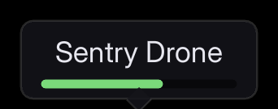

# Nameplates and world markers

A name over a head, an objective diamond or a waypoint that follows a place in the world while staying square to the camera and crisp.



For a document *in* the scene, with perspective and occlusion, see **[documents in the world](world_documents.md)**.

## The shortest version

Add a **Folio Marker Document** component to an actor and point it at a document:

| | |
|---|---|
| `Document Path` | `UI/hud/nameplate.rml` |
| `Size` | `256 x 96` (dp) |
| `Anchor` | `0.5, 1`: the bottom centre sits on the point |
| `Screen Offset` | `0, -16`: lift it clear of the head |

`rcss/recipes/nameplate.rml` is a complete one (name, health bar, tail) to copy into your own `UI/`.

## Distance

Everything here is off by default.

**`Scale With Distance`** shrinks it the way something in the world would. `Reference Distance` is where it draws at its authored size; `Min Scale` and `Max Scale` stop it becoming a dot or filling the screen. The document is laid out at its authored size and *then* scaled, so text never rewraps as the player walks towards it.

**`Fade Start Distance` and `Fade End Distance`** take it away across that stretch and stop drawing it past the second. Both zero switches this off. Distance is the cheapest way to thin thirty markers on a screen.

`folio.Marker.Test` puts one in front of the player with a fade band already set.

**`Distance Transition`** sets what it does across the stretch:

| | |
|---|---|
| `None` | Drawn or not drawn. |
| `Fade` | Opacity. The default. |
| `Scale` | Shrinks towards its anchor, so it recedes rather than dissolving. |
| `Fade And Scale` | Both, which reads as the marker going away rather than being switched off. |

Scaling eases out rather than running at a constant rate, and stops at **`Transition Scale`** rather than shrinking to an unreadable speck. The anchor is a fraction of the *scaled* document, so a marker shrinking towards a head stays on the head.

**`Clamp To Screen Edge`** keeps an off-screen marker at the edge, in the direction of the thing it labels. Right for objectives, wrong for nameplates. Behind the camera the projection mirrors through the origin, and the component corrects for that, so a marker behind you is pinned to the correct edge.

**`Clamp Start Distance` and `Clamp End Distance`** stop a marker being clamped past a distance, in world units, and hide it instead. Zero end is no limit, which is the default.

**`Clamp Transition`** is the same set of choices for that stretch, and applies only while the marker is clamped. A marker that is both far away and clamped goes through both bands and scales once rather than twice.

## Data

Bind an object and the document reads its properties:

```cpp
void AEnemy::BeginPlay()
{
    Super::BeginPlay();

    // Before the document loads. RmlUi resolves a document's bindings as it loads and offers no way
    // to attach a model afterwards, which is why this is not "bind whenever".
    Nameplate->BindViewModel(TEXT("nameplate"), NameplateModel);
    Nameplate->LoadDocument(TEXT("UI/hud/nameplate.rml"));
}
```

See **[data binding](data_binding.md)** for the document side. The nameplate recipe reads `Name` and `Health`, and colours its bar from `Health` with `data-class-*` rather than from code.

## What it costs

One document, one context and one draw per marker: thirty nameplates is thirty contexts.

An idle document is nearly free, and markers are usually idle. A nameplate whose health has not moved does no layout work; it is repainted from geometry that is already compiled.

*Changing* markers are what cost. Thirty health bars all animating is thirty layouts a frame. If that is your case, measure it with `stat Folio` before designing around it, and see **[performance](performance_profiling.md)**.

Markers you cannot see cost nothing to draw and still cost their update.

## Doing it yourself

To control placement yourself:

```cpp
FVector2D Screen;
if (UGameplayStatics::ProjectWorldToScreen(Controller, WorldLocation, Screen))
{
    // ProjectWorldToScreen returns viewport pixels; a document is laid out in dp. Mixing the two is
    // the mistake that makes a HUD correct on one monitor and wrong on every other.
    const float Dpi = UWidgetLayoutLibrary::GetViewportScale(World);
    Slot->SetPosition(Screen / Dpi - Size * Anchor);
}
```

Put a `UFolioWidget` in a canvas panel and drive its slot with that. The component saves writing the projection, culling, scale curve and fade, and getting the DPI conversion wrong.

## If it looks wrong

**A HUD widget draws over the markers.** The marker layer goes into the viewport at **Marker Layer Z Order**, 0 by default, under any widget with a higher order. Raise it above that widget's order in **Project Settings > Plugins > Folio**.

**A nameplate behind a wall still draws.** Markers do not occlude and cannot be occluded. Call `SetVisibility` to hide one.

**The lift above the head is right up close and wrong far away.** `Screen Offset` is in dp, so it is the same at every distance. Move the component to the head socket instead.

**The nameplate's name and health are empty.** The model was bound after the document loaded, and RmlUi resolves bindings only as a document loads. Call `BindViewModel` before `LoadDocument`, as in [Data](#data).

**A rim of arrows round the screen edge for things far behind the player.** `Clamp To Screen Edge` pins every off-screen marker. Set `Clamp End Distance` so distant ones hide instead.

**Thirty markers cost more than expected.** Markers you cannot see still cost their update. Set the fade distances so far ones stop drawing, and measure animating ones with `stat Folio`.

**Your own placement is right on one monitor and wrong on another.** `ProjectWorldToScreen` returns viewport pixels and a document is laid out in dp. Divide by `GetViewportScale`, as in [doing it yourself](#doing-it-yourself).

## Where to go next

- **[Documents in the world](world_documents.md)**: when the document should be *in* the scene.
- **[Data binding](data_binding.md)**: driving a marker from gameplay.
- **[Hosting a document](hosting.md)**: the same document in a normal widget tree.
