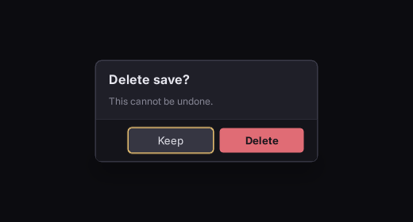

# Modals and focus trapping

A dialog that keeps mouse, keyboard and gamepad inside it until it closes.


## The short version

```html
<div class="screen" data-class-is-behind-modal="ShowConfirm">…</div>

<div class="modal-scrim" data-if="ShowConfirm"></div>
<div class="modal" data-if="ShowConfirm">
	<h2 data-loc="confirm_title">Delete save?</h2>
	<p data-loc="confirm_body">This cannot be undone.</p>
	<div class="modal-actions">
		<button class="btn btn-danger focusable" id="delete" data-loc="confirm_delete">Delete</button>
		<button class="btn focusable" id="cancel" autofocus data-loc="confirm_cancel">Keep</button>
	</div>
</div>
```

```css
/* Everything behind the dialog goes inert - both properties, for two different reasons. */
.screen.is-behind-modal { focus: none; pointer-events: none; }

.modal-scrim { position: absolute; left: 0; top: 0; width: 100%; height: 100%; }
.modal       { position: absolute; overflow: hidden; }
```

Each piece is load-bearing. A fresh document has nothing focused, so the first direction press takes the first tabbable element in document order, which is the content behind the dialog: `autofocus` puts focus in the dialog instead (on the safe choice, `Keep`, not `Delete`). `overflow: hidden` keeps it there, because the spatial focus search starts from the focused element's nearest scroll container, and any element whose `overflow` is not `visible` on either axis is one. `focus: none` inherits, so one class on the screen root takes everything behind out of navigation. It does not stop the mouse: a click on a `focus: none` element is forwarded to its nearest focusable ancestor, and `mousedown`, `mouseup`, `mouseover` and `:hover` still fire, so `pointer-events: none` takes the background out of hit testing as well.

## The scrim

```css
.modal-scrim { background-color: #0a0a0ec2; }
```

A flat wash is enough. If you want the screen to go soft behind the dialog:

```css
.modal { backdrop-filter: outside-blur(8dp); }
```

`outside-blur` is Folio's own. Where `blur` softens what is *behind* an element, this softens everything the element is *not*. It works in both renderers and reaches outside the UI, so the 3D scene blurs with it.

Two limits: the hole is a rectangle, so a `border-radius` dialog still cuts a square one, and it costs four blurred regions rather than one.

## Back and cancel

`Escape` and the gamepad's back button reach the document as an `Escape` keydown (`key_identifier` 81). Folio closes nothing; the document does not own the decision:

```html
<div class="modal" data-event-keydown="ShowConfirm = ev.key_identifier == 81 ? false : ShowConfirm"></div>
```

or listen in C++. See **[calling into game code](hosting.md)**.

## Stacking two

A second modal over the first needs the first to go inert too, by the same rule. Put the class on every layer that is not the top one, not only on the screen root. Drive `is-behind-modal` from one piece of game state that knows how deep the stack is, rather than from each dialog.

## Checking it

```bash
uipreview UI/screens/confirm.rml --root . --keys "down,right,up,left" --shot-each out/
```

If any shot shows focus behind the dialog, the trapping is wrong. Run it every time: the mouse path works throughout, so it is hard to spot by looking.

An incidental `overflow: hidden` on a layout wrapper confines focus the same way. **If focus refuses to leave a region, look for `overflow` first.**

`rcss/recipes/confirm.rml` is a working dialog with all of this in it.

## Where to go next

- **[Input and navigation](input_and_navigation.md)**: the `nav` rules everything here follows from.
- **[Components, themes and recipes](components_and_themes.md)**: the modal component and the recipe.
- **[Accessibility](accessibility.md)**: a dialog is the case where focus visibility matters most.
