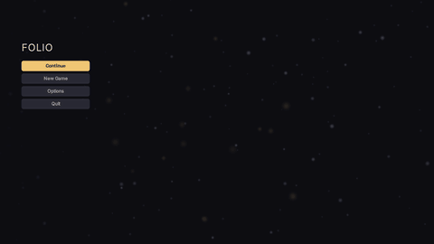

# Drifting motes

Slow specks falling behind a menu, at three depths. Nothing in the field is interactive or carries meaning.



```html
<link type="text/template" href="/folio/lib/lib.rml"/>
```
```html
<div class="motes">
	<div class="motes-layer motes-far">
		<div class="motes-scroll"><div class="motes-tile"/><div class="motes-tile"/></div>
	</div>
	<div class="motes-layer motes-mid">
		<div class="motes-scroll"><div class="motes-tile"/><div class="motes-tile"/></div>
	</div>
	<div class="motes-layer motes-near">
		<div class="motes-scroll"><div class="motes-tile"/><div class="motes-tile"/></div>
	</div>
</div>
```

`examples/motes.rml` is the whole thing over a menu.

## There are no particles

Each depth is one tile drawn twice, stacked, scrolled by a looping `translateY` on their shared parent. The tiles wrap top to bottom and the scroll travels exactly one tile, so the second copy arrives where the first started. Three depths at unrelated speeds read as parallax; a slow horizontal sway, at periods sharing no factor with the fall, stops the field appearing to pulse.

The whole thing is **six quads and one transform each**. Nothing is spawned or simulated, and the cost does not change with how many motes are in the art. RCSS has no seam for a real particle system, and motes that never collide or react do not need one.

## Where it goes

`.motes` is absolutely positioned and fills its parent, so **the parent has to be the thing it should cover**, with `position: relative` (or absolute) and `overflow: hidden` on it. Usually that is the document body. Anything after it in document order draws over it; `pointer-events: none` keeps it out of hit testing.

Add a wash between the field and the text wherever they overlap. A `horizontal-gradient` behind a menu column is enough (the example does this). Prefer linear to radial: against a near-black background a radial gradient bands into rings.

## Tuning it

Everything is a rule to restate in the game's own stylesheet, loaded after the library.

**Colour and strength** are `image-color` on the tiles:

```css
.motes-far  .motes-tile { image-color: #c8d0ff4d; }
.motes-mid  .motes-tile { image-color: #dce4ff66; }
.motes-near .motes-tile { image-color: #f0c67440; }
```

The tiles are white, so any colour is reachable. Raise the alpha before the brightness; a mote that reads as a light stays faint.

**Speed** is the animation duration. Slower is almost always better; the shipped near layer takes 19 seconds to cross the screen and still reads as too fast on a large display.

```css
.motes-near .motes-scroll { animation: 30s linear-in infinite motes-fall; }
```

The easing has to be `linear-in`. Any other curve accelerates and decelerates across the loop, and the seam becomes the one moment the field changes speed.

**Depth** is `filter: blur(3dp)` on a layer if the baked softness is not enough. It costs a full-screen render target per blurred layer, so bake it into the art instead with the generator's `falloff` parameter.

**Art** is three PNGs baked by `Tools/uiart/make_motes.py`, which takes count, radius, alpha and falloff per layer and stamps every dot at its wrapped neighbours so the tile wraps. Same seed, same bytes.

```bash
python Tools/uiart/make_motes.py
```

For hand-drawn art, point the decorator elsewhere. It must be a file rather than a sprite, tile vertically, and carry the box's aspect ratio (1920x1200dp, so 960x600), or every mote draws as an ellipse.

## The two decisions behind it

**A percentage in an animated `transform` never moves.** It is resolved once, when the animation starts, which on a document's initial style is before the first layout, so both ends of the keyframe collapse to zero. Nothing is logged. The fall is therefore a length, `1200dp`, and the tile height repeats it; change both together. See **[animation](animation.md)**.

Two stacked copies of height H cover any viewport up to H tall at every scroll offset, and under Unreal's default DPI curve a landscape viewport is about 1080dp tall whatever the resolution. A game that turns the dp follow down far enough to exceed 1200dp restates the height, the `top` on the first tile, and the keyframe.

**`image(src repeat)` would be the obvious way to tile, and `fill` is the better one.** A repeating tile is its texture's size in dp, so a 960dp tile across a 1920dp screen draws the same motes twice, side by side, which is visible. Stretching one tile over the box never repeats, costs the same, and only asks that the art carry the box's ratio.

## Accessibility

Reduced motion stops it. `@media (theme: reduced-motion)` in `folio.rcss` turns off every animation in the document, and the field settles into a still starfield.

High contrast removes it outright, in the theme, since a moving texture behind text is what high contrast exists to take away.

Neither needs anything from the document.

## Where to go next

- **[Animation](animation.md)**: the percentage trap in full, and what else is cheap to animate.
- **[Images and sprites](images.md)**: fit modes, and when a repeating tile beats a stretched one.
- **[Components and themes](components_and_themes.md)**, where a tint belongs, and how overriding works.
- **[Performance and profiling](performance_profiling.md)**: what a screen costs once it is drawing this.
