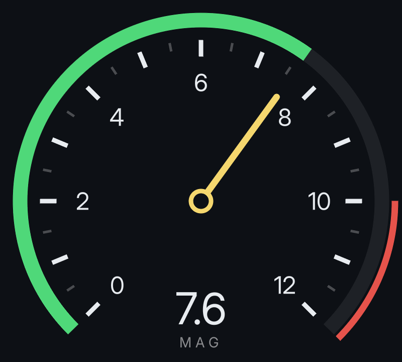

# Folio

**Custom UI Rendering Framework for Unreal Engine 5.** HTML/CSS-style markup provides rapid development and iteration. Polished results in minutes with Folio instead of days with UMG/Slate. Infinitely scalable; sharp at every size. Data-driven vector gauges written as plain text. World-space UI unaffected by TAA/TSR. Surface projected UI. Common game functionality included.

https://github.com/user-attachments/assets/99d463db-cf0a-4f49-a49e-746acc4db9af

Folio is free, source included, and built to be the UI layer of a shipping game, from a solo project to a full production, from indie to AAA.

## Get started

Requires Unreal Engine 5.8 or later, with Deferred or Forward rendering.

| | |
|---|---|
| **[Hello world](hello_world.md)** | Install the plugin and get a document on screen |
| **[Folio Studio](studio.md)** | The visual editor |
| **[UI_CONVENTIONS.md](../UI_CONVENTIONS.md)** | What the stylesheet language supports. It is close to CSS and is not CSS; read this before writing any |
| **[AGENTS.md](../AGENTS.md)** | The brief to hand an AI agent asked to build UI with Folio |
| **[Troubleshooting](hello_world.md#if-nothing-appears)** | A document that does not appear; [known gaps](known_gaps.md) for what Folio does not do yet |

## Showcase

https://github.com/user-attachments/assets/b95b546c-987c-4be1-976e-4d67f961374c


_Released a game using Folio? Get in touch and it may appear here_

## Why Folio

### Data-Driven Vector Gauges in Markup

Dials, tapes, arcs, needles and filled shapes are plain text, bound straight to game data with no game code. `<scale>` lays out a gauge's ticks and numbers, and `arc` and `wedge` turn a value into the shape that follows it. Each path is one draw, sharp at any size and angle.



```html
<scale kind="arc" from="0" to="12" step="0.5" major="1" centre="220 220" radius="160" start-angle="-135" end-angle="135"/>
<path class="value" data-attr-d="(Speed / 12) | arc(220, 220, 180, -135, 135)"/>
<path class="redline" data-attr-d="1 | wedge(220, 220, 196, 90, 135, 190)"/>
<path class="needle" d="M 220 220 V 92" data-style-transform="'rotate(' + (Speed / 12 * 270 - 135) + 'deg)'"/>
```

The whole gauge is `examples/gauge.rml`. See [paths](path.md) and [scales](scale.md).

### Fully Text Based

Build your entire UI in **[Folio Studio](studio.md)**, a cross-platform WYSIWYG editor that draws with the same renderer the game does, without your designer needing to install Unreal.

A minute of markup results in polished animated menus. The same thing in UMG or Slate is days or weeks in the clunky Unreal Engine editor.

No binary `.uasset` - it diffs, merges, and reviews like code, because it is code. No competing for p4 locks or git conflicts.


### Unparalleled Clarity + Limitless Scaling

Text and vector art are distance fields, resolved for the exact pixel they land on; always crisp and clear.

Regardless of resolution, or the use of `transform: scale(8)`, mid-animation, from across a room, or a VR player pressing their face into the cockpit display panel - the UI scales while remaining sharp.

Text has no atlas per font size and no blur when text grows, shrinks, or rotates. One field per glyph serves every size. Variable-weight fonts, outlines, and glows are part of the same field. Slate rasterises a bitmap for each size but Folio never does, resulting in superior fidelity under scale.

### No Smeared Post-Processing from TAA/TSR, Motion Blur

A text document on a computer screen, a sign or a cockpit panel is drawn after the tonemapper by default, where TAA, TSR, motion blur and post-processing cannot reach it.

World UI in Unreal normally smears the moment the camera moves; Folio documents do not. It is still depth-tested, so it clips geometry correctly.

Two other modes put it in the scene to take post-processing if desired.

https://github.com/user-attachments/assets/19c0910f-c940-40cd-a8e8-3668150aa3a3

### Surface-Projected UI

https://github.com/user-attachments/assets/5beac4d8-5f56-40ff-abe2-ccfbd6184fdd

Documents can be projected onto the surface of a mesh, with input enabled, so that CRT monitor the player can use? Already sorted as a byproduct of a proper tech foundation: [CRT terminal tutorial](tutorials/crt_terminal.md)

Surface projected documents are affected by post-processing. Any game that wants surface-projected UI with the same exceptional crispness should not use TAA/TSR - the ideal path is forward rendering with MSAA.

### Screen-Space UI Projected to World

Folio ships with a ready-made screen-space UI component that projects into world space. This includes a ton of parameters to reproduce common game functionality, such as keeping your nameplates clamped to the edge of a screen within a certain threshold.

### Real 3D Transforms

Modern UI often draw HUDs or menus with perspective instead of flat 2D panels. Folio supports this. For example:

```html
.vitals, .comms { transform: perspective(900dp) rotateY(38deg); transform-origin: 0% 50%; }
```


### Animation Built-In

Transitions, keyframes, springs that respond to the camera, and a shader decorator for scan lines, sweeps and additive glow.

Merely a single line of text for each element.


```html
.header
{
	display: flex;
	flex-direction: row;
	align-items: baseline;
	gap: 22dp;
	animation: 0.4s cubic-out cut-in;
}
```

### Animated Sprites

`<flipbook>` plays a sprite sheet or numbered frames, previewable in Folio Studio. Bind its clip, frame rate, pause or frame to game data and it follows the game.

Here Mario copies the player: walk, sprint, jump, fall and skid. Build it with the [sprite HUD tutorial](tutorials/sprite_hud.md).

VIDEO_URL

```html
<flipbook data-attr-sprites="Clip" data-attr-fps="Fps"/>
```

### Common Game Functionality Out-of-the-Box

All waiting for you in Folio Studio, either as a recipe or a tutorial. Don't waste time reproducing functionality common to many games, like UMG/Slate expects.

https://github.com/user-attachments/assets/397efa14-864e-40bd-b1ec-4de47caf4c0e

### Input and Menu Navigation

Keyboard and gamepad navigation works out-of-the-box, including rebinding. Want to support WASD, IJKL for left-handed users, mouse, and gamepad? If you have added Folio to your project, you already have it.

Folio provides spatial navigation, focus, modals, input prompts that swap when the player picks up a gamepad, with no focus code to write.

### Game-Driven Bindings

Bind any `UObject` by reflection: `{{ Health }}` in text, lists from arrays, commands back to C++ or Blueprint. No JavaScript and no binding code required.

### Virtual Reality Support

World documents render correctly under instanced stereo, verified with Unreal's emulated stereo. It has not yet been run on a headset. Full VR support is intended, so raise an [issue](https://github.com/Fogspire/Folio/issues) if anything doesn't work as expected. If it does work as expected, reach out anyway so this can be confirmed.

### AI Enabled Prototyping

A short prompt can come back as a finished working screen. Hand it [AGENTS.md](../AGENTS.md). May benefit from also handing it a concept image if available.

## Production Features

- **Accessibility.** Built with at minimum the following in mind: Screen reader that reads menus aloud, text scale, reduced motion, high-contrast settings. Build checks via verification harness. See [accessibility](accessibility.md).
- **Real text shaping.** HarfBuzz shapes every string: ligatures, contextual forms, combining marks, GPOS kerning and right-to-left scripts.
- **Localisation.** Strings are keyed in markup and gathered into Unreal's own localisation pipeline, with pseudo-localisation to find layouts that only fit English before translation exists.
- **A build gate.** `--strict` fails the build on a stylesheet mistake, the accessibility checks run beside it, and a verification harness diffs text metrics and screenshots between changes. The engine side carries its own automation tests.
- **Two renderers, one result.** The standalone preview and the engine share the font engine, the distance fields and the shader maths, and a parity check fails the build if the two drift.
- **Performance.** A document that has not changed costs nothing per frame. `stat Folio` and Unreal Insights scopes cover the whole path, and expensive effects bake to textures.
- **Fits your project design.** Hosts inside an existing UMG or CommonUI tree, so CommonUI activatable widgets keep working as the screen stack and input handler around a document, binds MVVM view models or plain objects, reads Enhanced Input, and stages documents for packaging. Documents are loose files, so UI can be changed on a device without cooking again.
- **Honest limits.** [What Folio does not do yet](known_gaps.md) lists every known gap in one place.
- **Source and licence.** All source is here. Use it in commercial games and change it freely; see [License](#license).

## In the box

### Menus

Main menu, pause menu, confirmation dialog, modal focus trapping, a controls screen that rebinds against Enhanced Input.

### HUD

Nameplates, world markers, bound input display.

Damage and low-health screen effects.


A helmet HUD that lags and settles with the camera.

https://github.com/user-attachments/assets/6a28104d-f75e-4d6d-82de-1aaeb25269ce

### Dialogue

A fading typewriter effect. Rich text with emphasis inside one translatable line. Shared names for places via localized lookup tables.

### Stamina Wheel


### Inventory

A grid with drag and drop, 3D items in cells, a paper doll, a list of ten thousand items that allocates nothing while scrolling.

### Terminals

CRT and LCD terminals that you can interact with. Draggable, resizable windows, text fields, and even a recycle bin.


### Classic Subtitles

Stacked closed captions in the classic shooter style. Several speakers at once, each line on its own timer.


### Components

Buttons, sliders, toggles, tab bars, lists, panels, scroll bars, drifting motes. All readily accessible from [Folio Studio](studio.md)'s library.


## Platform support

### Developing

| | Windows | macOS | Linux |
|---|---|---|---|
| The plugin in the Unreal editor | Supported | Beta | Beta |
| Building its libraries (`build_ue_libs.sh`) | Supported | Beta | Beta |
| Folio Studio | Supported | Beta | Beta |
| `uipreview` | Supported | Not ported | Not ported |

### Shipping

| Platform | |
|---|---|
| Windows | Supported |
| macOS, Linux | Beta |
| Nintendo Switch | Runs on a devkit |
| Other consoles | Not tried |

Folio is developed on Windows. The aim is for it to work as well everywhere else, so treat each new release as beta on macOS and Linux, and open an [issue](https://github.com/Fogspire/Folio/issues) when something does not work there. For a console, an issue is welcome too: support will be attempted where it can be.

---

To build Folio's tools or work on Folio itself, see [Building Folio](building.md). Dependencies and their pins are listed in [Internals](internals.md#dependencies-come-from-fetchcontent-not-vcpkg).

## License

[MIT with the Commons Clause](../LICENSE). In short:

| You may | |
|---|---|
| Use Folio in any game, commercial or not | Yes |
| Change it for your game | Yes |
| Publish your fork | Yes, under the same license |
| Sell Folio, or a product or service whose value is mostly Folio | No |

For a commercial license, open an issue or ask the author.

Contributions are accepted only with the right for the author to relicense them, so a commercial license can cover the whole of Folio.
