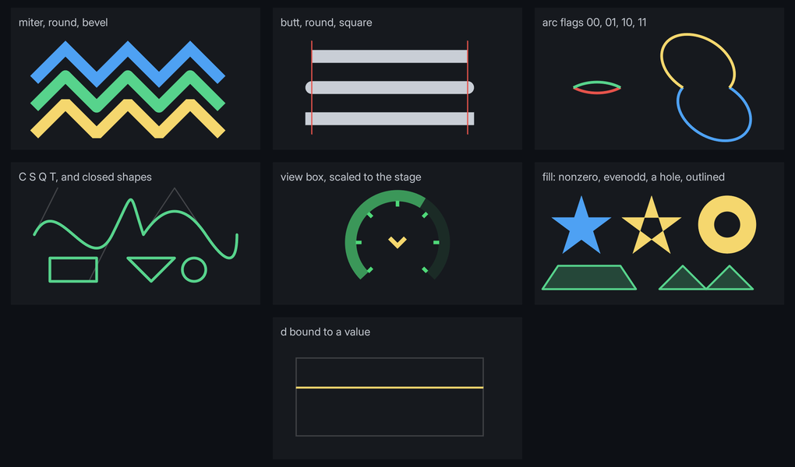

# Paths

`<path>` draws an SVG path: lines, curves and arcs, stroked with any join and cap, filled, or both. The whole path is one mesh and one draw, and `d` binds to data, so a gauge's arc, a chevron or a needle can follow the game.



```html
<path viewbox="0 0 100 100" d="M 20 80 A 40 40 0 1 1 80 80"/>
```

```css
path { display: block; width: 120dp; height: 120dp; color: #4fd879; path-width: 6dp; path-cap: round; }
```

The stroke is drawn in `color`. For a filled shape with no outline:

```css
.arrowhead { path-fill: #f5d76e; path-width: 0dp; }
```

Every path above is in `examples/path_styles.rml`, with its data in `UI/mock/path_styles.json`.

## Attributes

| | |
|---|---|
| `d` | SVG path data. Every command, either case: `M L H V C S Q T A Z`. |
| `fill-rule` | `nonzero` (the default) or `evenodd`: which overlaps of the shape count as inside. |
| `viewbox` | `min-x min-y width height`. The user space fitted into the content box, centred and uniformly scaled, as SVG's default. Without it a user unit is 1dp from the content box's top-left corner. |

Bind any of them with `data-attr-*`. A straight line can follow a value with arithmetic alone:

```html
<path data-attr-d="'M 0 ' + (100 - Level) + ' H 200'"/>
```

## Arcs and wedges from a value

Two transforms build path data for a gauge, with angles in degrees clockwise from straight up:

```html
<path data-attr-d="Speed | arc(150, 100, 94, -135, 135)"/>
<path data-attr-d="Heat | wedge(150, 100, 100, 90, 135, 94)"/>
```

| Transform | Draws |
|---|---|
| `Fraction \| arc(cx, cy, r, start, end)` | An arc of radius `r` round (`cx`, `cy`), from `start` as far as `Fraction` of the way to `end`. |
| `Fraction \| wedge(cx, cy, r, start, end)` | The same, closed through the centre into a pie slice for `path-fill`. |
| `Fraction \| wedge(cx, cy, r, start, end, inner)` | A ring segment between `inner` and `r`. |

`Fraction` is clamped to 0 to 1, so scale a value to it in the expression: `(Speed / 12) | arc(...)`. Folio adds both to every data model it creates. For a model the game creates itself, call `Folio::RegisterPathTransforms` on its constructor.

## Troubleshooting

- **Nothing draws:** `d` is empty, or `path-width` is 0 and `path-fill` is transparent. With a `viewbox`, the element also needs a size: give it `display: block` and a width and height.
- **`<path> d is unreadable at character N`:** parsing stopped there and the path draws up to it. A command letter is missing before the first number, a letter is not a path command, or an arc flag is something other than `0` or `1`.
- **A hole fills in:** both contours wind the same way. Draw the inner one the other way round, or set `fill-rule="evenodd"`.
- **`<path> viewbox ... needs four numbers`:** the view box is ignored and user units are dp.
- **A click goes through the path:** a path takes clicks only where it is drawn: inside its fill, or within half its width of the line, plus a pixel. A path with no fill is hollow. Give it a `path-fill`, or put the click on an element behind it.
- **`'arc' needs 5 arguments in brackets`:** the transform was given too few. Both take `cx, cy, r, start, end`.
- **The stroke is cut off at the edge of a view box:** it is not clipped; the half outside the box is drawn. Something else covers it, or the view box is tighter than the stroke.
- **The stroke stays the same width when the view box scales the shape:** `path-width` is a length, and the view box scales only coordinates. Scale the element with `transform` to scale both.

## Properties

| | Default | |
|---|---|---|
| `color` | inherited | The stroke's colour. Transitions like any colour. |
| `path-fill` | `transparent` | The fill's colour. Open subpaths are closed for the fill, which is drawn under the stroke. |
| `path-width` | `1dp` | 0 for a fill with no outline. Thinner than a pixel draws one pixel at reduced opacity. |
| `path-join` | `miter` | `round` or `bevel`. A mitre longer than four times the width bevels. |
| `path-cap` | `butt` | `round` or `square`. A subpath of zero length draws its cap alone: a dot for `round`, a square for `square`. |
| `path-dash` | `none` | Dash and gap lengths, alternating, such as `8dp 4dp`. Plain numbers are dp. An odd count repeats once more, as in SVG. Each dash gets the caps; `0 10dp` with `path-cap: round` draws dots. |
| `path-dash-offset` | `0dp` | How far into the pattern the path starts. Animate it to march the dashes. |

`opacity` applies to the whole path. Edges are antialiased over one pixel, so a path needs no supersampling at any angle.

## Where to go next

- **[Vector art](vectors.md)**: authored SVG art baked to sprites, for icons and drawings that do not move.
- **[Scales](scale.md)**: a gauge's ticks and numbers, generated as paths.
