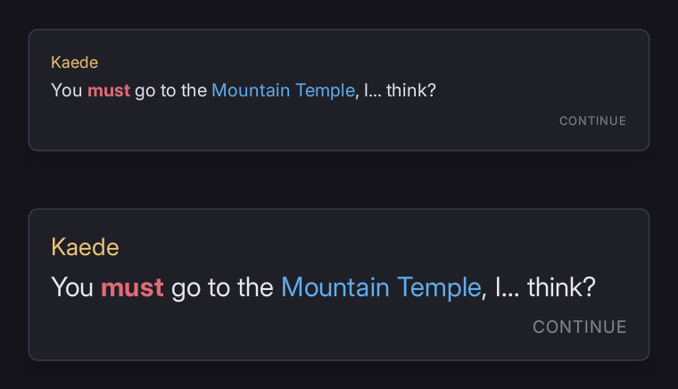
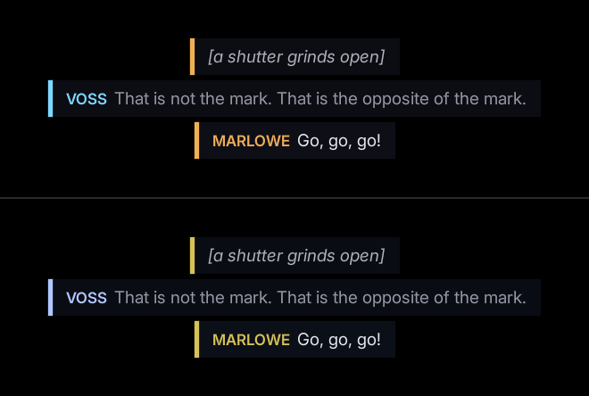

# Presentation settings

Larger text, less movement, higher contrast, no screen effects and paced or instant text, each one line of game code against a stylesheet written to expect it.

## Turn them on

```cpp
UFolioAccessibilityLibrary::SetTextScale(1.5f);      // 0.5 to 3, 1 being as authored
UFolioAccessibilityLibrary::SetReducedMotion(true);
UFolioAccessibilityLibrary::SetHighContrast(true);
```

These change how a screen looks and nothing about what it means. All are global, reach documents opened afterwards, and are off by default and never inferred from the operating system. [Screen effects](#screen-effects) and [text speed](#text-speed) are set the same way.

`folio.Accessibility.TextScale`, `.ReducedMotion` and `.HighContrast` do the same from the console.

Preview a screen with a setting on before shipping it:

```bash
./bin/win64/uipreview.exe UI/screens/settings.rml --root . --a11y --text-scale 1.5
```

## If it looks wrong

**Some text does not grow with the text scale.** It is sized in `dp`; the scale reaches only `rem`. `I-A11Y-FIXEDTEXT` ("this text does not move with the text scale - size it in rem rather than dp if it should") names each piece. Leave it if it is right not to move: a letter inside a key cap, a logo, a version string.

**Text overlaps or is cut off at a larger scale.** A fixed-height row whose label now overlaps the one under it. `W-A11Y-CLIPPED` ("content is cut off: ...") names it, and fails `--strict`.

**Something still moves under reduced motion.** Movement written from code every frame is outside the stylesheet. `UFolioHudMotion` reads the setting and snaps to rest; anything else you drive yourself should read `UFolioAccessibilityLibrary::IsReducedMotionOn` and do the same. A video and a render-target surface are outside it either way.

**A `<text>` still types itself out under reduced motion.** Deliberate: it has its own [text speed](#text-speed) setting.

**A screen ignores high contrast.** It writes its own colours in its own `<style>`, which a theme cannot reach. Answer the setting in that stylesheet; see [high contrast](#high-contrast).

**Turning screen effects off removes nothing.** No layer is marked. Add `folio-screen-effect` to each; see [screen effects](#screen-effects).

## Text scale

Applied by setting the root font size, so it reaches every rule written in `rem` and no rule written in `dp`. The shipped theme sizes all of its type in `rem` against one `dp` root:

```css
body       { font-size: 20dp; }   /* the root, and the only dp size in the theme */
.t-title   { font-size: 1.4rem; }
.t-body    { font-size: 1rem; }
```

Size your own type the same way. `I-A11Y-FIXEDTEXT` is measured rather than inferred from the unit, and is informational. `W-A11Y-CLIPPED` is a warning.

Every shipped recipe is checked at 150% as well as at 100%.



## Reduced motion

Vestibular disorders make large movement unpleasant, and a menu that slides, scales and parallaxes is the usual trigger.

It is a theme, `reduced-motion`, declared in `rcss/folio.rcss` (the user-agent stylesheet every document links), so it reaches a game's own rules and elements the theme has never heard of:

```css
@media (theme: reduced-motion)
{
    * { transition: none; animation: none; }
}
```

It also turns **smooth scrolling** off, which is not a transition: RmlUi glides a focused item into view from its own controller.

A shader decorator has no clock of its own; it moves only through a stylesheet animating the `decorator` property, which stops with everything else.

`uipreview --reduced-motion` turns on the same theme, for judging a screen with everything still.

## High contrast

`rcss/themes/default.rcss` carries a `high-contrast` block. The focus ring gains width as well as contrast, since a 2dp ring is often invisible to the players who need this, and disabled controls stop relying on opacity alone.

A screen that writes its own colours has to answer the setting itself, because a theme cannot reach a rule inside a document's own `<style>`:

```css
@media (theme: high-contrast)
{
    body { background-color: #000000; }
    h1   { color: #c6c6d2; }
}
```

Check one at the high-contrast ratio:

```bash
./bin/win64/uipreview.exe UI/screens/settings.rml --root . --theme high-contrast --a11y-contrast 7
```

## Screen effects

The washes and flashes a game paints over the whole view: a damage vignette, a burning tint, a hit flash. They are a legibility, motion and photosensitivity problem at once, and whoever needs one gone usually needs all of them gone.

Full-screen layers are the most expensive shape a document has: bake them and draw textures rather than using `box-shadow` or `filter` at screen size. See **[performance](performance_profiling.md)**.

Folio cannot tell a vignette from a panel, so **mark the layers**:

```html
<div id="base"    class="edge" folio-screen-effect/>
<div id="burning" class="edge" folio-screen-effect/>
<div id="hit"     class="edge" folio-screen-effect/>
```

```cpp
UFolioAccessibilityLibrary::SetScreenEffects(false);
```

On by default; nothing disappears from a game that has marked nothing. Mark what covers the view and reads as an effect; leave anything a player needs to see. `examples/screen_edge.rml` is the worked example, `folio.Accessibility.ScreenEffects` is the console, and `uipreview --no-screen-effects` previews it.

Pair it with `--flash-check` (see [flashing](accessibility.md#flashing)): the layer that trips the flash limit usually most needs marking.

## Text speed

Its own setting, not part of reduced motion:

```cpp
UFolioAccessibilityLibrary::SetTextSpeed(2.0f);      // 1 is as authored. Clamped to 0.1 - 10
UFolioAccessibilityLibrary::SetInstantText(true);    // every line arrives whole
```

Somebody can need menus still and dialogue paced, or instant text and every transition intact. A typewriter is also small, local, predictable movement, unlike what triggers a vestibular response.

**The multiplier divides the whole schedule** (`reveal-rate`, an authored `{delay:0.2}` and the punctuation beats move together), so a writer's pacing survives. Instant text skips rather than never starting, so `revealcomplete` still fires and whatever was waiting on the line still runs.

`uipreview --text-speed 4` and `--instant-text` preview both; `folio.Text.Speed` is the console.

## Colour vision

Around one man in twelve has some colour vision deficiency, and the person who drew the screen cannot see it fail.

```bash
./bin/win64/uipreview.exe UI/screens/settings.rml --root . --a11y --screenshot out.png \
    --simulate deuteranopia
```

Every capture is redrawn as that vision sees it, and the contrast pass runs again on the simulated colours. `W-A11Y-CVD` reports the pairs that pass as drawn and fail as seen. `protanopia`, `deuteranopia`, `tritanopia` and `achromatopsia` are the four, at full severity, using the Machado 2009 transforms.



No tool checks meaning carried by colour alone, such as a red bar and a green bar. Add a shape, a label or a position.

## Where to go next

- **[Accessibility checks](accessibility.md)**: the `--a11y` findings these previews report.
- **[Rich text](rich_text.md)**: the typewriter that text speed paces.
