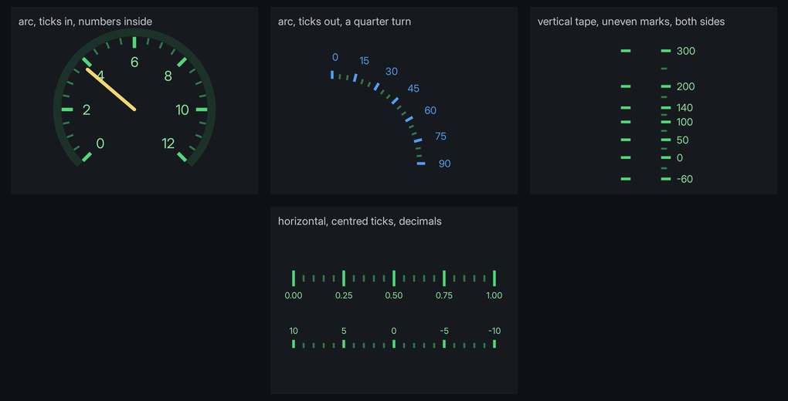

# Scales

`<scale>` lays a gauge's ticks and numbers along a line or an arc, from a range and a step, so a dial or a tape is one element instead of a div per tick.



```html
<scale kind="arc" from="0" to="12" step="0.5" major="2" centre="150 100" radius="94"
	start-angle="-135" end-angle="135" minor-length="8" major-length="14" label-offset="32"/>
```

```css
scale        { position: absolute; left: 0dp; top: 0dp; }
scale .minor { color: #4fd87980; path-width: 2dp; }
scale .major { color: #4fd879; path-width: 3dp; }
scale .label { font-size: 13dp; }
```

Positions and lengths are dp from the scale's own corner. The scale writes its marks as children, styled like any element:

| Child | |
|---|---|
| `<path class="minor">` | Every minor tick, as one [path](path.md). |
| `<path class="major">` | Every major tick. |
| `<span class="label">` | One per number. `label-class` adds classes, such as the game's own text style. |

Every scale above is in `examples/scale_styles.rml`.

## Attributes

All bind with `data-attr-*`.

| | |
|---|---|
| `from`, `to` | The values at either end. |
| `step`, `major` | Minor and major spacing, counted from `from`. A minor tick is not drawn where a major one is. |
| `minor-values`, `major-values` | Explicit lists instead, for marks that are not evenly spaced. |
| `kind` | `linear` (the default) or `arc`. |
| `start`, `end` | Linear: where `from` and `to` sit, as `x y`. |
| `centre`, `radius` | Arc: the centre as `x y`, and the radius the ticks start from. |
| `start-angle`, `end-angle` | Arc: degrees clockwise from straight up. |
| `minor-length`, `major-length` | Tick lengths. 6 and 10 when left out. |
| `side` | Which way ticks grow. Linear: `right` (the default) or `left` of the direction from `from` to `to`. Arc: `in` (the default) or `out`. `centre` straddles the line. |
| `labels` | `major` (the default) numbers every major tick, `none` numbers nothing, or a list of values. |
| `label-offset` | How far numbers sit from the line, the way the ticks grow. Major length plus 8 when left out. |
| `label-anchor` | `centre` (the default), `start` or `end`: which part of the number sits on its point. |
| `label-decimals` | Decimal places. Left out, a number shows as many as it needs. |
| `label-class` | Classes added to every label. |

## Troubleshooting

- **Nothing draws:** `from` equals `to`, or `step` and `major` are both left out. Ticks also need a `path-width` above 0 and a visible `color`.
- **Marks are in the wrong place:** the scale is not at the corner you measured from. Give it `position: absolute; left: 0dp; top: 0dp;` inside the box the coordinates are for.
- **A label's `width`, `text-align` or `margin-left` does nothing:** the scale sets those to anchor the number. Use `label-anchor`, and `margin-top` to nudge a number vertically.
- **Ticks run backwards on an arc:** `end-angle` is less than `start-angle`. Angles run clockwise from straight up.

## Where to go next

- **[Paths](path.md)**: what each tick is, and how to draw the needle or arc beside it.
