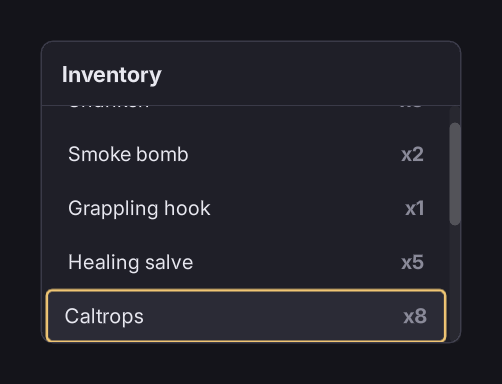

# Scrolling and scrollbars



## The trap

**An `overflow: auto` container needs its scrollbar sized, or it destroys its own layout.**

RmlUi ships no scrollbar styling, and an `auto` width on a scrollbar resolves to the container's full content width. The container lays out correctly until its content overflows. Then the scrollbar takes everything, every child collapses to its own padding and border, and text inside anything `overflow: hidden` disappears. It looks like a flex bug.

`/folio/folio.rcss` sets the geometry so this cannot happen:

```css
scrollbarvertical             { width: 10dp; }
scrollbarvertical sliderbar   { width: 10dp; min-height: 32dp; }
scrollbarhorizontal           { height: 10dp; }
scrollbarhorizontal sliderbar { height: 10dp; min-width: 32dp; }
```

**Do not override `scrollbarvertical`'s width with `auto`.** That brings the bug back.

## Styling one

The base stylesheet sets geometry only; the look belongs to the game:

```css
scrollbarvertical           { background-color: #ffffff0a; border-radius: 5dp; }
scrollbarvertical sliderbar { background-color: #ffffff33; border-radius: 5dp; }
scrollbarvertical sliderbar:hover  { background-color: #ffffff4d; }
scrollbarvertical sliderbar:active { background-color: #ffffff66; }
```

The stepper arrows are sized to zero by default. Give them a size if you want them:

```css
scrollbarvertical sliderarrowdec,
scrollbarvertical sliderarrowinc { width: 10dp; height: 10dp; }
```

## The consequence: focus gets confined

**Any element whose `overflow` is not `visible` on either axis is a scroll container**, and the spatial focus search starts from the focused element's *nearest* one.

So an incidental `overflow: hidden` on a layout wrapper (added to clip a corner, or to stop a decorator bleeding) silently confines focus to that wrapper, and nothing warns.

**If focus refuses to leave somewhere, look for `overflow` first.**

The same rule makes a modal trap focus. See **[modals and focus trapping](modals.md)**.

## Keeping the focused item in view

RmlUi scrolls a focused element into view when navigation moves to it, so a long list works with no code. It does not centre it. If the selection sits at the edge of the viewport after each step, the rows are usually taller than the padding around them: give the container a little vertical padding.

## `overflow` values

`visible`, `hidden`, `auto`, `scroll`. **No `clip`.**

`overscroll-behavior` takes `auto` or `contain`. `contain` stops a scroll that reaches the end from propagating to a parent container; use it on a nested list.

## Long lists

A list of ten thousand rows scrolls fine but builds ten thousand elements; see **[a list of ten thousand items](tutorials/long_lists.md)**.

## Where to go next

- **[Layout and panels](layout.md)**, where this trap lives alongside the other two.
- **[Input and navigation](input_and_navigation.md)**: the focus rules.
- **[A list of ten thousand items](tutorials/long_lists.md)**: when the content is the problem.
