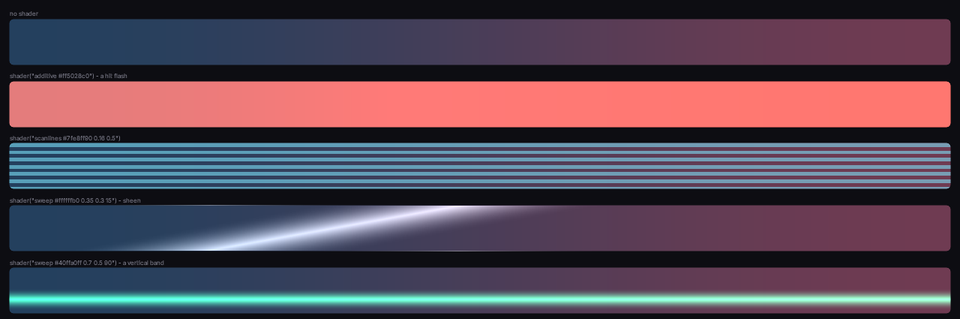

# The shader decorator

Three effects RCSS has no syntax for, reached through one decorator:



```css
.hit   { decorator: shader("additive #ff5028c0"), image(panel); }
.crt   { decorator: shader("scanlines #7fe8ff90 0.16 0.5"), image(panel); }
.sheen { decorator: shader("sweep #ffffffb0 0.35 0.3 15"), image(panel); }
```

**The set is fixed**; a stylesheet cannot add to it. A name Folio does not know warns once and draws nothing.

| | |
|---|---|
| `additive <colour>` | A flat wash that adds instead of covering. Hit flashes, charge glows, damage. |
| `scanlines <colour> <period> <thickness>` | Period and thickness as fractions of the box. |
| `sweep <colour> <position> <width> <angle>` | A soft band across the box, angle in degrees. Card sheens, loading shimmers. |

## Additive blending, which is the point

`additive` and `sweep` **add** rather than cover; RCSS has no blend modes and no other route to it.

No blend state is involved. RmlUi composites premultiplied, so a colour written with **zero alpha** adds to whatever is under it:

```css
/* Adds a red wash without darkening anything. */
.hit { decorator: shader("additive #ff502800"), image(panel); }
```

That works identically in both renderers, which a real blend state would not.

## Order matters, and it is backwards from what you expect

**Multiple decorators paint in reverse source order: the first named is on top**, exactly like CSS `background-image` layers.

An effect listed *after* an opaque background is painted underneath it and appears to do nothing:

```css
/* Wrong. The sheen is under the base and invisible. */
.btn { decorator: image(btn_base), shader("sweep #ffffffb0 0.35 0.3 15"); }

/* Right. */
.btn { decorator: shader("sweep #ffffffb0 0.35 0.3 15"), image(btn_base); }
```

This is the single most common reason a shader decorator "does nothing".

## Animating one

The decorator's arguments are not animatable: there is no interpolation between two `shader()` strings. Animate the *element* instead:

```css
@keyframes flash {
	from { opacity: 1; }
	to   { opacity: 0; }
}

.hit-overlay {
	position: absolute; left: 0; top: 0; width: 100%; height: 100%;
	pointer-events: none;
	decorator: shader("additive #ff502800");
	animation: 0.25s cubic-out flash;
}
```

An overlay with `pointer-events: none` can be added, animated and removed without touching the element it decorates.

For a sweep that travels, animate `transform: translateX` on an overlay wider than its container.

## Where to go next

- **[Images and sprites](images.md)**: the rest of the decorator vocabulary, and the ordering rule again.
- **[Animation](animation.md)**: what is cheap to animate.
- **[UI_CONVENTIONS.md](../UI_CONVENTIONS.md)** §5: the complete effect list.
