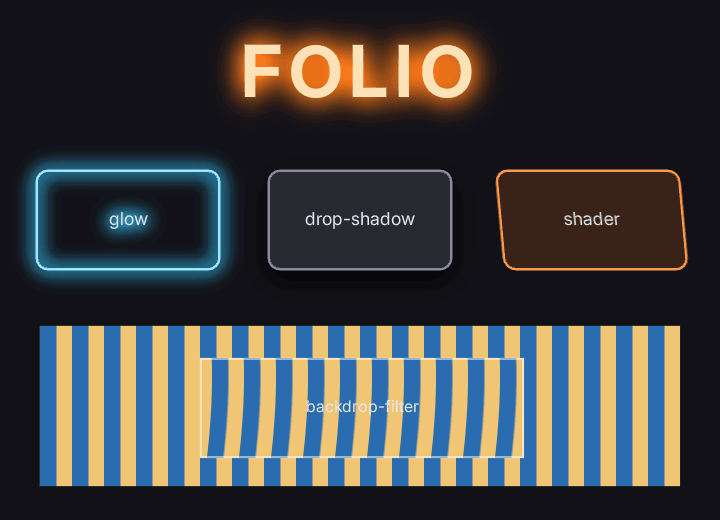

# Glow and shader filters

A halo of any size around text, icons or panels, a drop shadow, and your own GPU pass run over an element or over what is behind it.



`examples/shader_filters.rml` is this screen.

On a document in the world, these need the **Surface** [draw mode](world_document_settings.md#draw-modes); After Tonemap and In Scene draw the element unfiltered.

## Glow and drop shadow

```css
.title { filter: glow(#ff7a1a 28dp 2.5); }
.ring  { filter: glow(#38c8ff 18dp 4); }
.card  { filter: drop-shadow(#000000c0 0 10dp 12dp); }
```

`glow(<colour> <radius> <strength>)` blurs the element's own pixels, so it reaches as far as the radius says. A font effect `glow` stops at about 0.1em. Strength multiplies the halo's coverage: raise it to make a thin outline glow as brightly as a solid shape.

## A shader filter of your own

1. Write the pass. It is an `IFolioShaderFilter` from `FolioShaderFilters.h`: Folio hands it the element's layer as `Inputs.Input` and an output of the same size, inside its own render graph.

    ```cpp
    #include "FolioShaderFilters.h"

    class FHeatFilter final : public IFolioShaderFilter
    {
    public:
        virtual void AddPasses(FRDGBuilder& GraphBuilder, const FFolioShaderFilterInputs& Inputs) const override
        {
            // Read Inputs.Input, write every texel of Inputs.Output. Inputs.Args are the stylesheet's arguments.
        }
    };
    ```

2. Register it before the document loads, for example in your module's `StartupModule`:

    ```cpp
    Folio::RegisterShaderFilter(TEXT("heat"), MakeShared<FHeatFilter, ESPMode::ThreadSafe>());
    ```

3. Use it:

    ```css
    .panel { filter: shader("heat 4dp 3 1.5"); }
    .lens  { backdrop-filter: shader("heat 8dp 2 0.5"); }
    ```

    `filter` runs the pass over the element; `backdrop-filter` runs it over what is on screen behind the element.

The complete reference is `Source/Folio/Private/FolioExampleFilters.cpp` with `Shaders/Private/FolioHeat.usf`. `folio.Filters.RegisterExamples` registers it, and `examples/shader_filters.rml` then draws in the engine as above.

## See it in the preview and Studio

The pass is engine code, so `uipreview` and Folio Studio run a GLSL stand-in: `UI/filters/<name>.frag` in your project.

```glsl
// UI/filters/heat.frag
void main()
{
	float amplitude = folio_args[0].x * folio_pixel_scale / folio_size.x;
	vec2 uv = folio_uv();
	uv.x += amplitude * sin((uv.y * folio_args[1].x + folio_time * folio_args[2].x) * 6.2831853);
	folio_colour = folio_source(uv);
}
```

| Name | What it is |
| --- | --- |
| `folio_uv()` | This pixel, origin top left like the engine |
| `folio_source(uv)` | The layer, premultiplied |
| `folio_colour` | Write the premultiplied result here |
| `folio_args[16]` | The arguments in order: `.x` for a number or length, `.rgba` for a colour |
| `folio_arg_count` | How many arguments there are |
| `folio_size` | The layer in pixels |
| `folio_pixel_scale` | Pixels per document pixel |
| `folio_time` | Seconds. A program that reads it keeps the preview drawing |

## Troubleshooting

**The element draws unfiltered in the engine, and the log says `shader filter 'heat' is not registered`.** The document compiled the filter before `RegisterShaderFilter` ran. Register in `StartupModule`, or reload the document after registering.

**The preview draws it unfiltered and logs `has no preview program`.** Add `UI/filters/<name>.frag`.

**A world document draws the element unfiltered, and the log says it `used a layer effect`.** After Tonemap and In Scene have no offscreen target to filter in. Set the document's **Draw Mode** to **Surface**, or move the element to a document drawn to the screen.

**The effect is cut off in a straight line.** The layer is grown by the pass's reach, which is three times its largest length argument. Override `GetReach` to return how far, in document pixels, the pass draws past the element.

**An animated pass only moves when something else changes.** Override `IsAnimated` to return true. Its layer is then redrawn every frame instead of reused from the cache.

**A dark, soft glow shows steps.** Layers carrying a glow, drop shadow or shader filter are 16-bit float unless `folio.Layers.HalfFloat` has been set to `0`.

**A colour argument looks lighter or darker than written.** In the engine a pass receives colours in linear light, as the layer's pixels are. The preview passes them as written.

## Options

| Argument or setting | Default | What it does |
| --- | --- | --- |
| `glow` colour | `#ffffff` | The halo's colour |
| `glow` radius | `8dp` | Where the halo has faded |
| `glow` strength | `1` | Multiplies the halo's coverage before it is clamped |
| `shader("<name> <args>")` | | Arguments are numbers, lengths, colours or words, space separated |
| `IFolioShaderFilter::GetReach` | 3 x largest length | Pixels the pass draws past the element |
| `IFolioShaderFilter::IsAnimated` | `false` | Redraws the layer every frame |
| `folio.Layers.HalfFloat` | `2` | `0` 8-bit layers, `1` every layer float, `2` float for layers with a glow, drop shadow or shader filter |

A `backdrop-filter: shader(...)` region is the element's rectangle: `border-radius` does not round it. It runs only for documents drawn to the screen, not into a render-target surface.
