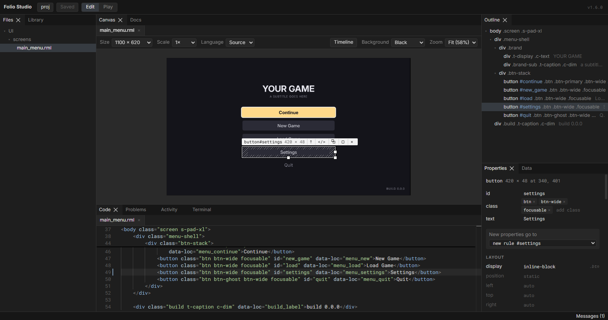
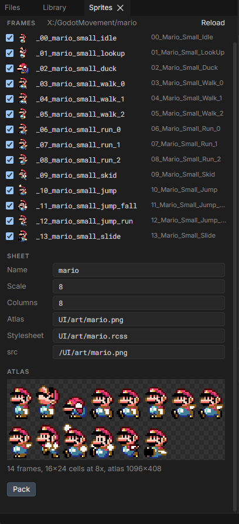

# Folio Studio reference

Every panel, mouse action, shortcut and setting in [Folio Studio](studio.md).



## Panels

- **Files** lists the project's documents. Click an `.rml` to put it on the canvas, or an image or font to look at it. Right-click a folder for a new document, a new document from a recipe, or a new stylesheet, and a file to delete it.
- **Properties** edits styles, classes, attributes and text. Each value shows the rule it comes from; click the rule to open it in **Code**.
- **Library** has elements to drag onto the canvas, and recipes to start a new screen from. Click a recipe to preview it, then **Use** to copy it into `UI/screens/` and open the copy.
- **Sprites** packs a folder of pixel-art frames into an atlas and its `@spritesheet`. See [pack sprites](#pack-sprites).
- **Outline** shows the document's elements. Right-click one for cut, copy, paste, duplicate, delete and wrap.
- **Code** completes as you type: tags, attributes, RCSS properties and their values, classes from every stylesheet the document links, and inside a binding the model's fields, a row's members and its commands. Hover a name for what it does; Ctrl+click a class, id, binding or `href` to go to where it is defined. CSS that RCSS silently ignores, such as `text-shadow` or `transition: opacity 120ms`, is underlined with what to write instead, and so is whatever the renderer or the schema reports.
- **Data** lists each model the document binds and creates mocks and schemas. See [show a document's data](studio.md#show-a-documents-data).
- **Timeline** (Ctrl+Shift+T) holds the document's clock. Play it from the first frame, or drag to any moment, to see an entry animation that otherwise finishes before you look.
- **Problems** lists what the renderer rejected, what the accessibility checks found (contrast, text size, hit target size, controls with no name or no visible focus) and costly effects, with file and line. **With Notes** adds what needs no change, such as the mock it mounted. **Contrast** sets the ratio normal text is held to: 7:1 for a high-contrast theme. **Check Flashing** plays the document for three seconds from its first frame and reports flashing over three times a second, a seizure risk.
- **Screen Reader** lists what a screen reader reads out, in the order it reads it. A control with no name is shown in yellow; give it `folio-label`. Click a line to select its element.
- **Activity** says whether the document idles in the game, and names every animation that runs forever, what can wake it, and every element drawing a layer.
- **Terminal** is a shell in the project's folder. Copy is Ctrl+Shift+C, paste is Ctrl+V.
- **Messages** (in the bottom bar, or **View > Messages**) lists every message the top bar has shown this session. The top bar clears on your next click or key, or after a few seconds. The bottom bar explains whatever is under the pointer.

Every document you open stays open as a tab over the canvas and in **Code**. Click a tab to bring that document to the canvas. Middle-click closes a tab, and right-click closes the others or those to one side.

## Mouse and keys

| Action | What it does |
|---|---|
| Click | Selects an element. |
| Alt-click | Steps out to the parent. |
| Double-click text | Edits it in place. |
| Drag | Moves a positioned element, or reorders any other among its siblings. |
| Drag a handle | Resizes. A size set by a rule changes in that rule, so every element sharing it resizes; hold Shift to resize only this one. **Edit > Preferences** turns that off. |
| Right-click an element | Cut, copy, paste, duplicate, delete and wrap, on the canvas or in **Outline**. |
| Alt+Up, Alt+Down | Selects the parent, or the first child. |
| Alt+Left, Alt+Right | Selects the previous or next sibling. |
| Ctrl+wheel, Ctrl+=, Ctrl+- | Zooms the canvas. |
| Middle-drag | Pans the canvas. |
| Ctrl+0, Ctrl+1 | Fits the canvas in view, or shows it at actual size. |
| Ctrl+T | Goes to a file by name. Type any part of it, such as `alti` for `altitude.rml`, pick with Up and Down, and press Enter. Tab completes the chosen name. |
| Ctrl+Z | Undoes the last edit from anywhere outside a text editor. |
| Ctrl+S | Saves. |
| Alt+Shift+F | **Edit > Format Document**: fixes indentation and spacing in an `.rml` or `.rcss`. It never moves anything onto another line, keeps aligned columns, and leaves comments and `<text>` as written. |
| Ctrl+Shift+T | Opens **Timeline**. |
| F10 | **View > Layout > Reset Layout**. |

**Revert** in the top bar, **File > Revert Unsaved Changes**, or a tab's right-click menu puts unsaved files back as they are on disk. Undo brings the changes back.

## Canvas

| Control | What it does |
|---|---|
| Size | The viewport the document is laid out in. A document with `<meta name="folio-size" content="960x640"/>` opens at that size, at Scale 1×. |
| Scale | The dp ratio. Auto follows the viewport height against 1080, as the game does. |
| Player | The player's own settings, as the game's options menu sets them: input device and confirm button (which change the input prompts), text size, colour vision, themes, screen effects, reduced motion, instant text and text speed. The button shows how many differ from the defaults. Colour vision draws the canvas as that vision sees it and holds contrast to it. |
| Language | The language the document is drawn in. Source is the text as written, Pseudo lengthens every string by about 40% and accents it to find layouts that only fit English, and each `UI/loc/<culture>.json` is listed by name. See [Localisation](localization.md). |
| Zoom | How large the canvas is drawn. Zoomed in, the document is drawn with more pixels, as on a larger screen, so text stays sharp. Lengths in `dp` and `rem` scale with it; lengths in `px` keep their size, which can move a layout that relies on them. |
| Edit / Play | Edit selects and changes elements. Play sends the mouse and keyboard to the document, so hover, focus, navigation and `data-event-*` behave as in game. |

## Bake to PNG

Right-click an element, then **Bake to PNG**, to render it alone to an image, so a costly effect or a slanted edge can ship as a texture.

- **Samples** draws it at two or four times the pixels and averages them down, which smooths an angled edge at the same size.
- **Background** puts it over white, black, 50% grey or a colour you pick instead of leaving it transparent.

Right-click an `.rml` in **Files** to bake the whole document, or a folder to bake every document in it to a PNG of the same name, into that folder or one you choose. A layer effect has to be baked in the editor with `folio.Bake`; see [bake a layer effect](performance_profiling.md#bake-a-layer-effect).

## Pack sprites



Right-click a folder of PNG frames in **Files** and choose **Pack PNGs as Sprites**, or click **Frames Folder** in **Sprites** for a folder outside `UI/`. Rename each sprite in its row, untick a frame to leave it out, and drag rows to set the atlas order. Click a cell in the atlas preview to rename its frame. **Pack** writes:

- the atlas PNG, each frame scaled up by **Scale** with sharp pixels, in a cell the size of the largest frame, standing on the cell floor;
- the stylesheet, an `@spritesheet` declaring the same resolution, so each sprite's natural size is still its original pixel size in dp;
- `<stylesheet>.spritepack.json` beside it, which remembers the pack. Click it in **Files**, or use **Open Pack**, to change it or pack again after editing the art.

Link the stylesheet and draw a sprite by name: `` or `decorator: image(hero_walk_0)`. `Tools/uiart/pack_sprites.py --pack <file>.spritepack.json` packs the same sheet from the command line, to the same pixels.

## Where a style edit is written

- A property that one of your rules already sets is changed in that rule.
- A property nothing of yours sets yet goes to the target in **New properties go to**: one of the element's own rules, a new rule for its id or class in the document's `<style>` block, or its `style` attribute.
- Rules under `/folio/` are never edited.

## Layout

Studio reopens with the panels as you left them. **View > Layout > Save Layout As** writes the arrangement to a file, and layouts saved in the folder it offers are listed in the same menu. **Load Layout** opens one from anywhere.

## Preferences

**Edit > Preferences** sets the terminal's shell and arguments, the font size of the terminal and of **Code**, whether an `.rml` or `.rcss` is formatted on save, on Enter (and `}` or `>`), on paste or when **Code** loses focus (all off by default), and whether Studio restores the last layout and checks for updates when it starts.

With no shell set, the terminal runs Git Bash on Windows when it is installed and PowerShell otherwise, and `$SHELL` on macOS and Linux. The `FOLIO_STUDIO_SHELL` environment variable is used before those defaults.

## Keyboard shortcuts

**Edit > Keyboard Shortcuts** lists every command. Change gives one a new key, taking it from whatever had it; Remove leaves it with none; Default puts it back.

Ctrl+Shift+click an item in the menu bar to set or remove that item's key without opening the list.

## Changing the renderer

Only needed after changing C++ under `Tools/uipreview`, `Tools/studio/engine` or `Source/FolioCore`:

```bash
./scripts/studio.sh engine     # rebuilds the WebAssembly renderer; fetches Emscripten on first use
./scripts/studio.sh parity     # compares its output with native uipreview
./scripts/studio.sh test
```

Commit `Tools/studio/engine/dist` and `Tools/studio/app/src/lang/vocabulary.json` afterwards. The vocabulary is the properties, keywords and effects **Code** completes and checks, read from RmlUi's and FolioCore's sources; `python Tools/studio/engine/vocabulary.py` writes it on its own. `scripts/verify.sh` fails while the renderer build is older than its sources.
