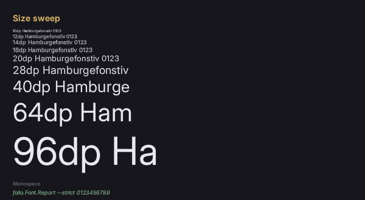

# Text and fonts

Sharp text at any size, under `transform: scale`, at 4K and at any DPI, in your own fonts, with outlines, glows and shadows.



Glyphs are distance fields, so one atlas per face serves 13dp and 96dp alike.

## Getting a face

`font-family` accepts **one** family only, with no fallback stack. The host registers faces, or a stylesheet declares them with `@font-face`.

Folio bundles Inter and Roboto Mono, so `font-family: Inter` works in a new project with no setup. A game adds its own by dropping files in `UI/fonts/`; the preview takes `--font <path>`.

```css
body { font-family: Inter; font-size: 16dp; }
.code { font-family: Roboto Mono; }
```

A family name is one Folio registered, not a filename. The faces come from the first of these that has any: `--font`, the game's `UI/fonts/`, the plugin's bundled faces, the engine's Roboto. They are alternatives, not a stack.

**The bundled two are a floor, not the palette.** [fonts.google.com](https://fonts.google.com) is an open-licensed library: fetch the `.ttf`, put it in `UI/fonts/`, ship the licence beside it.

### `@font-face`

```css
@font-face { font-family: "Hand"; src: url(fonts/hand.ttf); }
@font-face { font-family: "Hand"; src: url(fonts/hand-bold.ttf); font-weight: bold; }
@font-face { font-family: "Display"; src: url(fonts/display-variable.ttf); font-weight: 100 900; }
```

`src` resolves against the stylesheet. `font-weight` takes `normal`, `bold`, 1 to 1000, or a range for a variable file. `font-style` takes `normal` or `italic`.

Faces are global, not per document: the first declaration of a family, style and weight is the one every document gets, for as long as the game runs.

## Weight

```css
.light  { font-weight: 300; }
.body   { font-weight: normal; }   /* 400 */
.strong { font-weight: 600; }
.heavy  { font-weight: bold; }     /* 700 */
```

On a variable face any value in 1-1000 drives the `wght` axis directly rather than snapping to the nearest cut. Values are quantised in steps of 50, so `375` and `425` are distinct instances and `375` and `380` are not.

`bolder` and `lighter` do not exist.

`opsz`, where a face has it, is driven automatically from the requested size. Other axes (`wdth` and anything custom) are pinned at registration and reached by family name:

```cpp
// On the font engine, which the module owns. Style and the pinned axes are both explicit, because a
// family is what RCSS can name and everything else has to be baked into one.
FFolioModule::Get().GetFontEngine()->RegisterVariableFace(
    "<path>", "Inter Condensed", Rml::Style::FontStyle::Normal, {{"wdth", 75.0f}});
```

```css
.narrow { font-family: Inter Condensed; }
```

## Size, and the one real trade-off

Distance-field text has **no hinting and no stem snapping**. At 12-14dp on a 1080p display, stem widths vary slightly more than a hinted rasteriser would give. Above that it is a wash or better. `--a11y` treats 12dp as a hard floor; see **[accessibility](accessibility.md)**.

**Advances are unhinted and scaled linearly from design units**, so text wraps in slightly different places than a hinted rasteriser would.

## Font effects

Four, and the only way to get a text shadow.

```css
.title  { font-effect: outline(2dp #000000); }
.glow   { font-effect: glow(3dp #f0c674); }
.drop   { font-effect: shadow(2dp 2dp #000000a0); }
.soft   { font-effect: blur(4dp #ffffff40); }
```

All four read the field's true-distance channel, so each costs one more quad per glyph and no atlas.

Widths and offsets take `dp`, `px` or `em`. `dp` keeps its proportion to the text at every UI scale; `px` stays the same number of pixels.

**Their reach is bounded in em, not pixels**: 0.104em at the default atlas settings. `outline(2px)` is a twentieth of an em on 40dp text and well inside it; on 13dp text it is a sixth of an em and gets clamped. Size an effect against the text it decorates.

## Textured text

`fill-image` fills the glyphs with a pattern instead of a flat colour:

```css
.crt { font-effect: fill-image("/UI/art/scanlines.png" 4dp); }
```

A path, a tile size, and an optional colour the pattern is multiplied by. Where the pattern is transparent the flat `color` shows through, so the two compose.

## Shaping

Text is shaped with HarfBuzz: ligatures, contextual forms, attached combining marks, and the GPOS kerning a modern face ships, which a reader of the old `kern` table misses.

Shaping is always on. The one control is `font-kerning: none`, which switches off the `kern` feature and leaves everything else.

Shaping is per script: a string is cut into runs of one script each and each run shaped on its own, with punctuation and digits staying with whatever they follow. Right-to-left text lays out right to left. Mixing the two directions in one paragraph does not work; see [known gaps](known_gaps.md).

`folio.Font.Shaping 0` (or `uipreview --simple-shaping`) drops back to one glyph per codepoint with legacy kerning, which is what a build without HarfBuzz does. It exists for metrics diffs; text reflows when it changes.

## Text properties

`font` `font-family` `font-size` `font-style` `font-weight` `font-kerning` · `font-effect` · `text-align` `text-decoration` `text-transform` `text-overflow` · `letter-spacing` `line-height` · `white-space` `word-break`.

- **`line-height` has no `normal`.** Always give a number, length or percentage.
- **`font-style` has no `oblique`.**
- **`text-overflow` takes `clip`, `ellipsis`, or a string** to use in place of the ellipsis.
- `white-space`: `normal`, `pre`, `nowrap`, `pre-wrap`, `pre-line`. `word-break`: `normal`, `break-all`, `break-word`.

## Baking and caching

Glyphs are generated on demand and cached to disk, so only the first run of a face pays for them. `Tools/msdfbake font` pre-bakes a face for a packaged build.

`folio.Font.Report` (or `uipreview --font-report`) prints which faces are loaded, their variation tuples, and what they cost in pages and glyphs.

## If it looks wrong

**A document shows no text at all.** RCSS's initial `font-family` is empty, so nothing renders until a family is named. Set `font-family` on `body`.

**Text set in `Inter` or `Roboto Mono` disappears after you add a font.** Once `UI/fonts/` has a face in it, the bundled two are not loaded. Put Inter in `UI/fonts/` too, or name your own family.

**An `@font-face` has no effect.** The first declaration of a family, style and weight wins for as long as the game runs; a later one naming a different file is ignored with a warning, which `--strict` fails on. A face the host registered first also wins. Give the new face its own family name.

**Small body text looks uneven.** Distance-field text is unhinted, so at 12-14dp on a 1080p display stem widths vary slightly. Look at your smallest text on the target display before committing to it.

**Words wrap differently at another resolution.** Line breaks do not survive a change of dp ratio: an advance is a whole number of pixels at each size, so words move. Never size a container to fit its content exactly at one ratio; check two with `--dp-ratio`.

**`text-shadow` does nothing.** It does not exist. Use `font-effect: shadow(...)`.

**An outline or glow is thinner than asked on small text, and widening it changes nothing.** Effects are capped at 0.104em, and an effect at three times the cap looks identical to one at the cap. The log says `a font effect reaches further than the field describes and was clamped to 0.104 em`. Size the effect to the text, or raise `pxrange` when baking, at a quadratic cost in atlas area.

**`fill-image` cannot find a sprite.** It names a file, not a sprite: a font effect is built while the stylesheet is parsed and has no route to a spritesheet. Give it a path.

**The `fill-image` pattern stays still while the text scrolls.** The pattern is anchored to the screen, not to the text, so it is the wrong tool for anything meant to travel with the words.

**An outline, glow or shadow stays flat under `fill-image`.** It only textures the fill, as a front layer over the glyph.

**`fill-image` disappears inside a `filter`, a `mask-image` or an `opacity` on an ancestor.** Those paths bind one texture and the pattern is skipped.

**`text-align: justify` leaves the text left-aligned.** Justification is not implemented; the value parses and does nothing.

**A screen holds more font pages than expected.** Run `folio.Font.Report` to catch one that instantiated nine weights.

## Where to go next

- **[Rich text and the typewriter](rich_text.md)**: emphasis inside a translatable line, names shared across the game, and text that types itself out.
- **[Vector art](vectors.md)**: the same distance fields, for icons.
- **[Localisation](localization.md)**: translated strings run about 40% longer; check with `--culture pseudo` before it matters.
- **[Accessibility](accessibility.md)**: the size floor and the contrast check.
- **[UI_CONVENTIONS.md](../UI_CONVENTIONS.md)** §6: the full reference.
