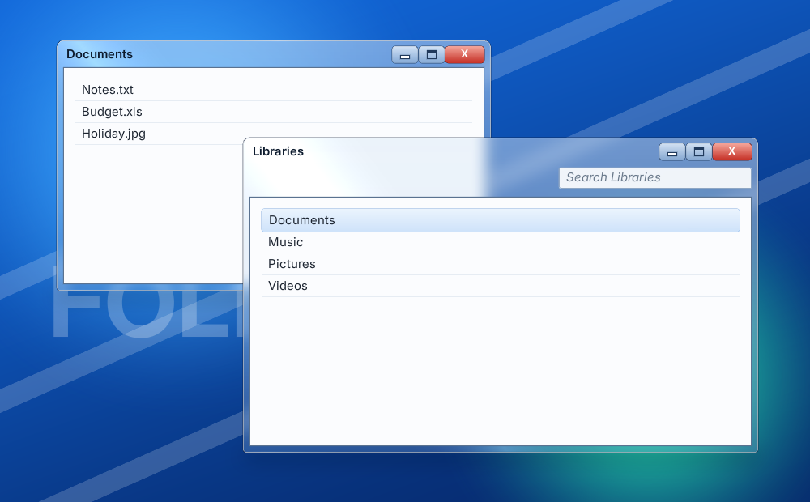

# A frosted glass window

A window frame that blurs whatever is behind it, while its title, buttons and contents stay sharp.



The finished document is `examples/glass_window.rml`. Open it in Studio from **Library > Examples**.

---

## 1. The glass

Five properties on the window element:

```css
.window {
	border-radius: 8dp 8dp 4dp 4dp;
	border: 1dp #0a1a3299;
	background-color: #7fb2e533;
	backdrop-filter: blur(8dp);
	box-shadow: #00000080 0 6dp 24dp 0, #ffffff80 0 0 0 1dp inset;
	decorator: shader("sweep #ffffff26 0.3 0.35 -25"),
	           vertical-gradient(#ffffff59 #ffffff0d);
}
```

| Property | Gives |
|---|---|
| `backdrop-filter: blur(8dp)` | The frosting: blurs what is behind the element, never the element or its children. |
| `background-color` | The tint. Keep the alpha low (`33` here); an opaque background hides the blur. |
| `box-shadow` | A drop shadow, plus a 1dp white `inset` rim for the glass edge. |
| `vertical-gradient` | The gloss: bright at the top, fading down. |
| `shader("sweep ...")` | The diagonal streak. It adds light rather than covering. See [the shader decorator](../shader_decorator.md). |

## 2. Sharp contents

Give the content area its own opaque background, and pad the window so a band of glass shows around it:

```css
.window { padding: 0 7dp 7dp 7dp; }
.client { background-color: #fbfcfe; }
```

## When it goes wrong

| Symptom | Cause |
|---|---|
| The text and buttons blur too | `filter: blur()` is on the window. It blurs the element and everything inside it; use `backdrop-filter`. |
| No blur visible | The background is too opaque, or nothing busy is behind the window. |
| The streak or gloss does nothing | It is listed after an opaque decorator. The first decorator is drawn on top. |
| No blur on a world document | Layer effects work only in **Surface** mode. |
| Blur looks different in the VSCode preview | The preview does not match the engine for layer effects. Judge it in the engine. |

## Going further

- **A blurred backdrop behind a modal**: `backdrop-filter: outside-blur(6dp)` blurs everything except the element.
- **Cost**: each element with `backdrop-filter` or `box-shadow` is its own offscreen pass. Studio's **Activity** names every element drawing one. Never animate its `width` or `height`; animate `transform` instead.
