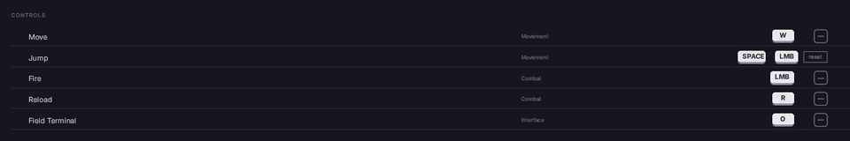

# A controls screen

Every action the player can rebind, the keys currently on it, and a press-any-key panel that catches whatever they hit next, including keys the game itself has bound. Written as markup against a model Folio ships, so the screen is a list and four commands.



The finished thing is `rcss/recipes/bindings.rml`. Copy it and change how it looks.

---

## 1. Where the bindings come from

**Enhanced Input's own user settings, and nowhere else.** `UEnhancedInputUserSettings` holds the player's key profile, saves it, and is what every other system already reads. `UFolioInputBindings` is a view of that profile, not a copy, so there is no second table to reconcile on load, reset or patch:

```cpp
Bindings = NewObject<UFolioInputBindings>(this);
Bindings->Initialise(GetOwningLocalPlayer());

Document->BindViewModel(TEXT("bindings"), Bindings);
Document->LoadDocument(TEXT("UI/screens/controls.rml"));
```

`Bindings` is an array of rows, each with the mapping name, the action's display name and category, the primary and secondary keys as text, and whether the player has customised it.

**An action only appears if it is player mappable.** That is a checkbox on the Input Action asset, or an override in the mapping context. A profile with nothing mappable produces an empty screen and a warning in the log saying so.

## 2. The list

```html
<div class="bind" data-for="row : Bindings">
    <span class="action">{{ row.Action }}</span>
    <span class="cat">{{ row.Category }}</span>

    <span class="pg pg-key focusable" data-if="row.PrimaryKey != ''"
        data-event-click="Rebind(row.Mapping, row.PrimarySlot)">{{ row.PrimaryKey }}</span>
    <span class="pg pg-unbound focusable" data-if="row.PrimaryKey == ''"
        data-event-click="Rebind(row.Mapping, row.PrimarySlot)">&#8212;</span>

    <span class="reset focusable" data-if="row.bCustomised"
        data-event-click="ResetBinding(row.Mapping)">reset</span>
</div>
```

**The keycap is the library's `pg-key`**, the same component a prompt uses. A rebind row and an in-game prompt for the same key then look identical. See **[input prompts](../input_prompts.md)**.

**An unbound slot is still a control.** `pg-unbound` draws an empty cap rather than nothing, because a row with a blank space in it gives the player nowhere to click to *add* a binding.

**`reset` appears only on a customised row.** `bCustomised` comes from Enhanced Input.

## 3. Catching the key

`Rebind(mapping, slot)` starts listening. Pass the row's `PrimarySlot` or `SecondarySlot`, not 0 and 1: a row holds the keyboard and the pad keys together, so the column is not the engine slot, and writing to the wrong one replaces the other device's key.

While it waits, `bListening` is true and `Listening` names the action:

```html
<div class="over" data-class-on="bListening">
    <div class="big">PRESS A KEY FOR {{ Listening }}</div>
    <div class="small">Escape cancels</div>
</div>
```

**The capture is an input pre-processor, not a focused widget.** A focused widget never sees a gamepad face button, a mouse thumb button or a key the game has bound to crouch, or sees them after the game has acted. A pre-processor runs before any of it and takes the event.

Escape or the pad's view button cancels rather than binding, because a player who has changed their mind needs one key that is never a binding. A key from the other device is swallowed and ignored, so a keyboard page never takes a pad button.

## 4. When the key is already taken

A key already on another action is not stolen silently; the player confirms with `ConfirmConflict`:

```html
<div class="over" data-class-on="bConflict">
    <div class="big">{{ ConflictKey }} IS ALREADY {{ ConflictWith }}</div>
    <span class="reset focusable" data-event-click="ConfirmConflict">rebind anyway</span>
    <span class="reset focusable" data-event-click="CancelRebind">cancel</span>
</div>
```

`ConflictWith` is the *display names* of the actions already on that key, not their mapping names.

## 5. The rest of the commands

| | |
|---|---|
| `Rebind(mapping, slot)` | Listen, then apply. |
| `CancelRebind()` | Stop listening, or dismiss the conflict warning. |
| `ConfirmConflict()` | Apply the key that was already taken. |
| `ClearBinding(mapping)` | This device's keys to nothing. |
| `ResetBinding(mapping)` | This device's keys back to the action's default. |
| `ResetAll()` | Every action, on this device. |

Each applies and saves through Enhanced Input, then re-reads the profile, so the list shows what was stored. A mapping the engine refuses shows up as the row not changing, with the reason in the log.

## 6. What to check before shipping it

**Rebind something to a key the game uses.** The capture takes the event, so the game must not also act on it while the panel is up. If your pawn moves while you are choosing a key, something is registered ahead of Folio's pre-processor.

**Rebind with a gamepad.** The face buttons have to reach the panel; with CommonUI, an input config can take them first. See **[hosting a document](../hosting.md)**.

**Clear a binding, then look at the game's prompts.** A prompt for an unbound action should say so rather than show a stale key: `bBound` on a prompt is false and the row can hide itself.

**Reset to default, and restart.** Reset writes through to the saved profile; if a restart brings the old binding back, the save did not happen, and the UI does not tell you.

## Where to go next

- **[Input prompts](../input_prompts.md)**: showing those bindings everywhere else in the game.
- **[Hosting a document](../hosting.md)**: focus, and what CommonUI does to it.
- **[Data binding](../data_binding.md)**: the model side, and why the commands take strings.
