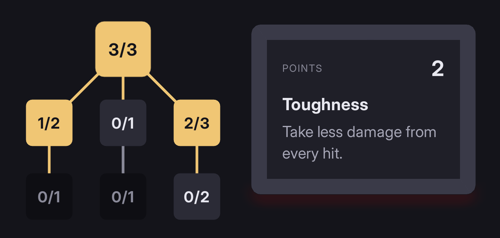

# A skill tree

Skills on a grid joined by lines, a points total, and a pane describing the focused skill. Confirm learns it, and the skills that needed it unlock.



The markup is the `skill_tree.rml` recipe. This page writes the game side: the model it binds and the rules behind it.

---

## 1. Start from the recipe

In Folio Studio, open **Library**, click **skill_tree** under **Recipes**, then **Use**. Studio copies it to `UI/screens/skill_tree.rml` with its mock data, and opens it.

The canvas draws the tree from the mock. The recipe's header comment lists every field it reads.

---

## 2. The model

```cpp
USTRUCT(BlueprintType)
struct FSkillNode
{
	GENERATED_BODY()

	UPROPERTY(BlueprintReadOnly, Category = "Skills") FString Name;
	UPROPERTY(BlueprintReadOnly, Category = "Skills") int32 X = 0;
	UPROPERTY(BlueprintReadOnly, Category = "Skills") int32 Y = 0;
	UPROPERTY(BlueprintReadOnly, Category = "Skills") int32 Rank = 0;
	UPROPERTY(BlueprintReadOnly, Category = "Skills") int32 MaxRank = 1;
	UPROPERTY(BlueprintReadOnly, Category = "Skills") bool bLocked = false;

	// Rules only: without BlueprintReadOnly the document never sees them.
	UPROPERTY() FString Text;
	UPROPERTY() int32 Cost = 1;
	UPROPERTY() TArray<int32> Requires;
};

USTRUCT(BlueprintType)
struct FSkillLink
{
	GENERATED_BODY()

	UPROPERTY(BlueprintReadOnly, Category = "Skills") int32 X1 = 0;
	UPROPERTY(BlueprintReadOnly, Category = "Skills") int32 Y1 = 0;
	UPROPERTY(BlueprintReadOnly, Category = "Skills") int32 X2 = 0;
	UPROPERTY(BlueprintReadOnly, Category = "Skills") int32 Y2 = 0;
	UPROPERTY(BlueprintReadOnly, Category = "Skills") bool bLit = false;

	UPROPERTY() int32 From = 0;
};

UCLASS()
class USkillTree : public UObject
{
	GENERATED_BODY()

public:
	UPROPERTY(BlueprintReadOnly, Category = "Skills") int32 SkillPoints = 0;
	UPROPERTY(BlueprintReadOnly, Category = "Skills") TArray<FSkillNode> Skills;
	UPROPERTY(BlueprintReadOnly, Category = "Skills") TArray<FSkillLink> SkillLinks;

	UPROPERTY(BlueprintReadOnly, Category = "Skills") FString SelectedName;
	UPROPERTY(BlueprintReadOnly, Category = "Skills") FString SelectedText;
	UPROPERTY(BlueprintReadOnly, Category = "Skills") FString SelectedNeeds;
	UPROPERTY(BlueprintReadOnly, Category = "Skills") int32 SelectedCost = 0;

	UFUNCTION(BlueprintCallable, Category = "Skills") void SelectSkill(int32 Index);
	UFUNCTION(BlueprintCallable, Category = "Skills") void LearnSkill(int32 Index);

	int32 AddSkill(const FString& Name, int32 X, int32 Y, int32 MaxRank, const FString& Text, const TArray<int32>& Requires = {});

private:
	void Refresh();

	int32 Selected = 0;
};
```

`X` and `Y` are grid cells, not dp. The markup multiplies them by the 96dp pitch.

Folio binds only `BlueprintReadOnly` properties and `BlueprintCallable` commands. See **[data binding](../data_binding.md)**.

---

## 3. The rules

```cpp
int32 USkillTree::AddSkill(const FString& Name, int32 X, int32 Y, int32 MaxRank, const FString& Text, const TArray<int32>& Requires)
{
	FSkillNode& Node = Skills.AddDefaulted_GetRef();
	Node.Name = Name;
	Node.X = X;
	Node.Y = Y;
	Node.MaxRank = MaxRank;
	Node.Text = Text;
	Node.Requires = Requires;

	for (const int32 Parent : Requires)
	{
		FSkillLink& Link = SkillLinks.AddDefaulted_GetRef();
		Link.From = Parent;
		Link.X1 = Skills[Parent].X;
		Link.Y1 = Skills[Parent].Y;
		Link.X2 = X;
		Link.Y2 = Y;
	}

	Refresh();
	return Skills.Num() - 1;
}

void USkillTree::SelectSkill(int32 Index)
{
	Selected = Index;
	Refresh();
}

void USkillTree::LearnSkill(int32 Index)
{
	if (!Skills.IsValidIndex(Index))
	{
		return;
	}

	SelectSkill(Index);
	FSkillNode& Node = Skills[Index];
	if (Node.bLocked || Node.Rank >= Node.MaxRank || SkillPoints < Node.Cost)
	{
		return;
	}

	SkillPoints -= Node.Cost;
	++Node.Rank;
	Refresh();
}

void USkillTree::Refresh()
{
	for (FSkillNode& Node : Skills)
	{
		Node.bLocked = Node.Requires.ContainsByPredicate([this](int32 Parent) { return Skills[Parent].Rank == 0; });
	}

	for (FSkillLink& Link : SkillLinks)
	{
		Link.bLit = Skills[Link.From].Rank > 0;
	}

	if (!Skills.IsValidIndex(Selected))
	{
		return;
	}

	const FSkillNode& Node = Skills[Selected];
	SelectedName = Node.Name;
	SelectedText = Node.Text;
	SelectedCost = Node.Rank < Node.MaxRank ? Node.Cost : 0;

	SelectedNeeds.Reset();
	for (const int32 Parent : Node.Requires)
	{
		if (Skills[Parent].Rank == 0)
		{
			SelectedNeeds += SelectedNeeds.IsEmpty() ? TEXT("Needs ") : TEXT(", ");
			SelectedNeeds += Skills[Parent].Name;
		}
	}
}
```

A skill is locked until every skill it requires has at least one rank. A line is lit once the skill it leads out of has a rank. Change either rule in `Refresh`.

A refused `LearnSkill` does nothing. Play a sound there if the player needs to hear it.

---

## 4. Bind it

Build the tree, bind it, then load the document. The tree below is the one in the mock:

```cpp
Tree = NewObject<USkillTree>(this);
Tree->SkillPoints = 2;

const int32 Toughness = Tree->AddSkill(TEXT("Toughness"), 1, 0, 3, TEXT("Take less damage from every hit."));
const int32 Sprint = Tree->AddSkill(TEXT("Sprint"), 0, 1, 2, TEXT("Run faster for longer."), { Toughness });
const int32 SecondWind = Tree->AddSkill(TEXT("Second Wind"), 1, 1, 1, TEXT("Recover stamina faster."), { Toughness });
const int32 IronSkin = Tree->AddSkill(TEXT("Iron Skin"), 2, 1, 3, TEXT("Armour lasts longer."), { Toughness });
Tree->AddSkill(TEXT("Vault"), 0, 2, 1, TEXT("Climb low walls without stopping."), { Sprint });
Tree->AddSkill(TEXT("Last Stand"), 1, 2, 1, TEXT("Survive one killing blow."), { SecondWind });
Tree->AddSkill(TEXT("Bulwark"), 2, 2, 2, TEXT("Block from behind."), { IronSkin });

Document->BindViewModel(TEXT("skill_tree"), Tree);
Document->LoadDocument(TEXT("UI/screens/skill_tree.rml"));
```

Folio reads the tree once a frame, so a rank learned anywhere in the game shows on the next frame.

---

## Check it

Switch the canvas to **Play** and press the arrow keys. Focus moves to the skill straight above, below or beside, never a diagonal one.

## If it does not work

- **Confirm does nothing in Studio:** expected. `SelectSkill` and `LearnSkill` do nothing until the game binds the model, so the pane and the ranks stay as the mock has them.
- **Down goes to a diagonal neighbour:** two nodes touch. Keep the gap between them: spatial navigation picks the node straight below only when no other node shares its edge. See **[input and navigation](../input_and_navigation.md)**.
- **Lines miss the node centres:** the pitch changed in one place. The node's `data-style-left` and `data-style-top` and the link's `data-attr-d` all multiply by 96, and the link adds 32, half a node.
- **A packaged build logs `Could not get value from data variable`:** a top-level property or command came back in another case. Rename it to something no other code uses.

## Making it yours

- **An icon instead of the rank:** add a `BlueprintReadOnly` `FString Icon` to `FSkillNode` and put `` in the node. See **[images](../images.md)**.
- **A bigger tree:** add 96dp to `.tree`'s `width` per column and to its `height` per row.
- **Cost per rank:** set each node's `Cost` from its `Rank` at the top of `Refresh`.

## Where to go next

- **[A grid inventory](grid_inventory.md)**: commands that serve mouse, keyboard and pad alike.
- **[Paths](../path.md)**: curved links, dashes and arcs.
