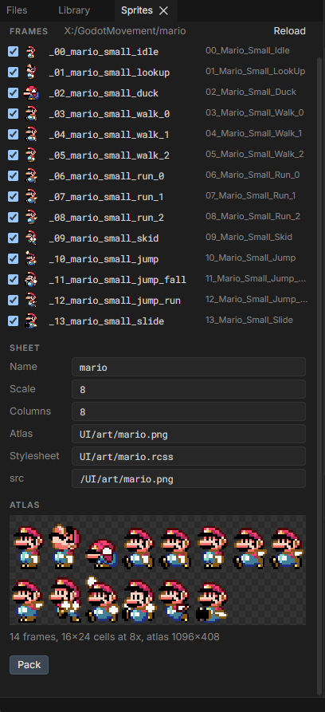

# A sprite that copies the player

A pixel-art character on a HUD panel, angled toward the crosshair, that walks when the player walks, runs when they sprint, jumps, falls, ducks and skids with them. This builds it with Mario's frames from Super Mario World; use any character's.

https://github.com/user-attachments/assets/faf97aa0-4169-426c-a537-802e8cb1ad27

You need Folio running in a project ([hello world](../hello_world.md)), `uipreview` built, a player pawn that is an `ACharacter`, and your frames as loose PNGs.

## 1. Pack the frames into one sheet

A flipbook plays from one texture, and its frames must share one size so the feet stay put between poses. Pack the loose frames into one atlas, naming each sprite `<clip>_<number>`: `mario_idle_0`, `mario_walk_0` to `mario_walk_2`, and so on. A clip with one pose still gets a `_0`, so every clip plays the same way.

### Option 1: Folio Studio



1. In [Folio Studio](../studio.md), right-click the frames folder in **Files** and choose **Pack PNGs as Sprites**. For a folder outside `UI/`, click **Frames Folder** in **Sprites** instead.
2. In **Sprites**, rename each frame in its row. Untick a frame to leave it out; drag rows to reorder the atlas.
3. Click **Pack**. It writes `UI/art/mario.png`, `UI/art/mario.rcss` and `UI/art/mario.spritepack.json`, which you can click in **Files** to change the pack and pack again.

### Option 2: Python

Needs Pillow (`pip install pillow`).

```bash
python Plugins/Folio/Tools/uiart/pack_sprites.py <frames folder> UI/art/mario.png UI/art/mario.rcss \
	--sheet mario --src /UI/art/mario.png \
	--map 00_Mario_Small_Idle=mario_idle_0 --map 01_Mario_Small_LookUp=mario_lookup_0 \
	--map 02_Mario_Small_Duck=mario_duck_0 \
	--map 03_Mario_Small_Walk_0=mario_walk_0 --map 04_Mario_Small_Walk_1=mario_walk_1 --map 05_Mario_Small_Walk_2=mario_walk_2 \
	--map 06_Mario_Small_Run_0=mario_run_0 --map 07_Mario_Small_Run_1=mario_run_1 --map 08_Mario_Small_Run_2=mario_run_2 \
	--map 09_Mario_Small_Skid=mario_skid_0 --map 10_Mario_Small_Jump=mario_jump_0 --map 11_Mario_Small_Jump_Fall=mario_fall_0 \
	--map 12_Mario_Small_Jump_Run=mario_runjump_0 --map 13_Mario_Small_Slide=mario_slide_0
```

It prints `14 frames, 16x24 cells at 8x`, and also writes `UI/art/mario.spritepack.json`, so Studio can open the same pack.

Both scale the art up 8 times with nearest-neighbour filtering. Folio filters textures smoothly, so 16px art drawn at 112dp straight from the source would blur.

## 2. Draw one clip

`UI/screens/mario_hud.rml`:

```html
<rml>
<head>
	<title>Mario HUD</title>
	<link type="text/rcss" href="/folio/folio.rcss"/>
	<link type="text/rcss" href="/UI/art/mario.rcss"/>
	<style>
		body { background-color: #00000000; width

: 100%; height: 100%; pointer-events: none; }

		.plate {
			position: absolute;
			left: 66%; top: 50%; margin-top: -110dp;
			width: 180dp; height: 220dp;
			display: flex; align-items: flex-end; justify-content: center;
			padding-bottom: 18dp; box-sizing: border-box;
			border-width: 2dp; border-color: #7fd0ff90; border-radius: 10dp;
			background-color: #0a1a2a55;
		}

		.plate flipbook { width: 112dp; height: 168dp; }
	</style>
</head>
<body data-model="mario">
	<div class="plate">
		<flipbook data-attr-sprites="Clip" data-attr-fps="Fps"/>
	</div>
</body>
</rml>
```

`sprites="mario_walk_"` plays `mario_walk_0`, `_1` and `_2` in a loop, and binding it lets the game swap the clip.

Give the preview something to bind in `UI/mock/mario.json`:

```json
{ "Clip": "mario_walk_", "Fps": 10.0, "bFaceRight": false }
```

```bash
./bin/win64/uipreview.exe UI/screens/mario_hud.rml --root . --size 1920x1080 --strict
```

Mario walks in a panel right of centre. Change `Clip` to `mario_run_` and save: he runs.

## 3. Turn the panel toward the crosshair

Wrap the panel in a full-screen element with the vanishing point at the centre of the screen, and turn the panel on its left edge:

```html
<body data-model="mario">
	<div id="hud">
		<div class="plate">
			<flipbook data-attr-sprites="Clip" data-attr-fps="Fps"/>
		</div>
	</div>
</body>
```

```css
#hud {
	position: absolute; left: 0; top: 0; right: 0; bottom: 0;
	perspective: 900dp;
	perspective-origin: 50% 50%;
}

.plate { transform: rotateY(-32deg); transform-origin: 0% 50%; }
```

The panel's outer edge now comes toward the camera and its face looks back at the middle of the screen, like a cockpit display. Keep the angle between 20 and 40 degrees; steeper squashes the art.

## 4. Face the way he moves

The art faces right. Mirror it when the game says to face left:

```html
<div class="plate" data-class-face-left="!bFaceRight">
```

```css
.plate.face-left flipbook { transform: scaleX(-1); }
```

Set `bFaceRight` to `true` in the mock and save: he turns around. A transform on the flipbook composes with the panel's, so the mirrored sprite stays on the angled panel.

## 5. Write the view model

The document reads three values. Put them on a small `UObject`:

```cpp
UCLASS()
class USpriteHudViewModel : public UObject
{
	GENERATED_BODY()

public:
	UPROPERTY(BlueprintReadOnly, Category = "SpriteHud")
	FString Clip = TEXT("mario_idle_");

	UPROPERTY(BlueprintReadOnly, Category = "SpriteHud")
	float Fps = 8.0f;

	UPROPERTY(BlueprintReadOnly, Category = "SpriteHud")
	bool bFaceRight = false;
};
```

`BlueprintReadOnly` is what makes a property visible to the markup.

## 6. Put it on screen

An actor owns the document and the view model. In `BeginPlay`:

```cpp
ViewModel = NewObject<USpriteHudViewModel>(this);

Document = NewObject<UFolioWidget>(this);
Document->DocumentPath = TEXT("UI/screens/mario_hud.rml");
Document->bInteractive = false;
Document->BindViewModel(TEXT("mario"), ViewModel);

SlateWidget = Document->TakeWidget();
GetWorld()->GetGameViewport()->AddViewportWidgetContent(SlateWidget.ToSharedRef(), 10);
FSlateApplication::Get().SetAllUserFocusToGameViewport();
```

Remove `SlateWidget` from the viewport in `EndPlay`. `bInteractive = false` keeps a HUD from taking focus; see [a HUD is not a screen](../hosting.md#a-hud-is-not-a-screen).

Spawn the actor from a `UWorldSubsystem`, so no game mode or HUD class needs to change:

```cpp
bool USpriteHudSubsystem::ShouldCreateSubsystem(UObject* Outer) const
{
	const UWorld* World = Cast<UWorld>(Outer);
	return World && World->IsGameWorld() && !IsRunningDedicatedServer();
}

void USpriteHudSubsystem::OnWorldBeginPlay(UWorld& InWorld)
{
	Super::OnWorldBeginPlay(InWorld);
	Hud = InWorld.SpawnActor<ASpriteHudActor>();
}
```

The view model is bound before the document loads, so the mock steps aside. Start PIE: Mario stands in the panel, idle.

## 7. Pick the clip from the character's movement

Tick the actor and read the player's `ACharacter`. Each state the movement component can report becomes a clip:

```cpp
const UCharacterMovementComponent& Movement = *Character.GetCharacterMovement();
const FVector Velocity = Movement.Velocity;
const float Speed = Velocity.Size2D();
const bool bAirborne = Movement.IsFalling();
const bool bSprinting = Speed >= SprintSpeed;

// A running jump keeps its pose for the whole jump, so decide it as the feet leave the ground.
if (bAirborne && !bWasAirborne)
{
	bRunJump = bWasSprinting;
}
bWasAirborne = bAirborne;
bWasSprinting = bSprinting && !bAirborne;

const FVector Acceleration = Movement.GetCurrentAcceleration();
const bool bSkidding = !bAirborne && Speed > 150.0f && Acceleration.SizeSquared2D() > 1.0f
	&& FVector::DotProduct(Acceleration.GetSafeNormal2D(), Velocity.GetSafeNormal2D()) < -0.3f;

const TCHAR* Clip;
float Fps = 8.0f;
if (bAirborne)          Clip = bRunJump ? TEXT("mario_runjump_") : Velocity.Z > 0.0 ? TEXT("mario_jump_") : TEXT("mario_fall_");
else if (Character.bIsCrouched) Clip = Speed > 250.0f ? TEXT("mario_slide_") : TEXT("mario_duck_");
else if (bSkidding)     Clip = TEXT("mario_skid_");
else if (Speed < 10.0f) Clip = FRotator::NormalizeAxis(Character.GetControlRotation().Pitch) > 35.0f ? TEXT("mario_lookup_") : TEXT("mario_idle_");
else if (bSprinting)    { Clip = TEXT("mario_run_");  Fps = FMath::Clamp(Speed / 40.0f, 10.0f, 20.0f); }
else                    { Clip = TEXT("mario_walk_"); Fps = FMath::Clamp(Speed / 35.0f, 4.0f, 12.0f); }

ViewModel->Clip = Clip;
ViewModel->Fps = FMath::RoundToFloat(Fps);
```

- **Sprinting** here is a speed threshold, which works on any `ACharacter`. If your movement component has a sprint state, ask it instead.
- **The frame rate follows speed**, so his legs match the ground he covers. Rounding it stops a speed that wobbles by a few cm/s from rewriting the attribute every frame.
- **Skidding** is acceleration pointing against velocity: the player reversed while still moving.

Then face him the way he moves sideways, relative to the camera, and back toward the crosshair otherwise:

```cpp
const FVector Right = FRotationMatrix(FRotator(0.0, Character.GetControlRotation().Yaw, 0.0)).GetUnitAxis(EAxis::Y);
const float Sideways = FVector::DotProduct(Velocity, Right);
if (FMath::Abs(Sideways) > 60.0f)
{
	ViewModel->bFaceRight = Sideways > 0.0f;
}
else if (!bAirborne)
{
	ViewModel->bFaceRight = false;
}
```

Folio reads the view model once a frame and only touches the document when a value changed. A flipbook carries on from its current frame when its `fps` changes, so speeding up never restarts the cycle.

Play: walk and he walks, sprint and he runs, jump and he jumps and falls, strafe and he turns, reverse hard and he skids, look up while standing and he looks up.

## If it does not work

- **Nothing on screen, and the log says `Could not find sprite 'mario_walk_0' specified in flipbook`.** The `<link>` to the sheet's `.rcss` is missing or its path is wrong, or `Clip` does not match the names the packer wrote.
- **He blurs.** The art was not scaled before packing, or `resolution` in the `.rcss` does not match `--scale`.
- **A thin line flickers along one edge of the sprite.** Frames packed edge to edge bleed into each other under filtering. The packer leaves a gap; a sheet from another tool needs one too.
- **He slides between poses.** The frames are different sizes. Pack them into equal cells, standing on the cell's bottom edge.
- **He never runs.** Your sprint speed is below the threshold. Log `Speed` while sprinting and set the threshold under it, or read your movement component's sprint state.
- **The player cannot turn the camera after alt-tab.** `bInteractive` is still `true`, and the document does not declare `folio-interactive` false.

## Next

- **[Flipbooks](../flipbook.md)**: pausing, seeking and driving every frame from game data.
- **[HUD motion](../hud_motion.md)**: making the panel trail the camera.
