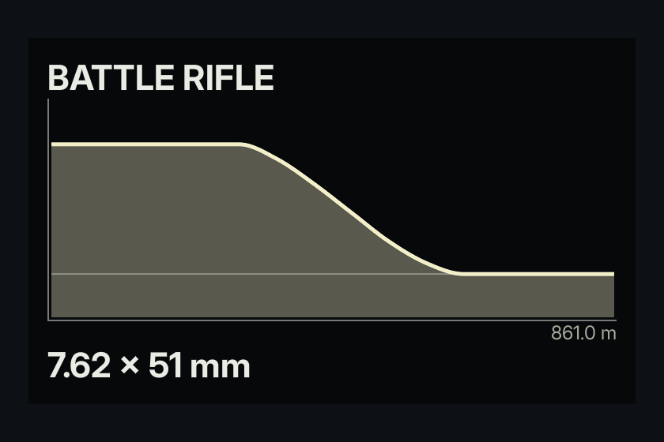
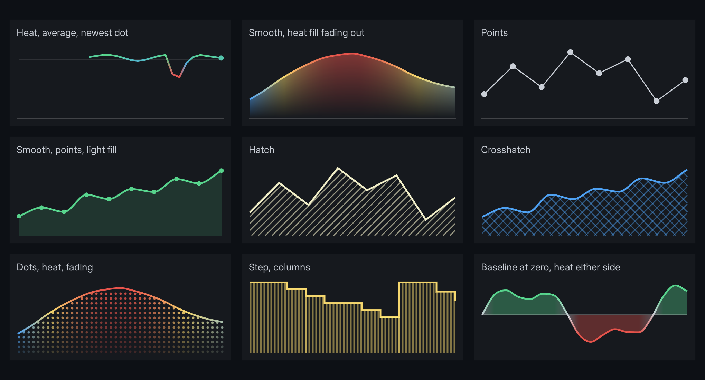

# A weapon falloff graph

A weapon card with a damage-over-range curve drawn by `<line-graph>`, fed from a mock JSON file first and from game code after. Then heat colouring, points and patterned fills.



The finished document is `examples/weapon_falloff.rml`, with mock data in `UI/mock/weapon_falloff.json`. Open it in Studio from **Library > Examples**.

---

## 1. The mock

`values` takes **one string of numbers**, not a JSON array:

```json
{
	"Name": "BATTLE RIFLE",
	"Calibre": "7.62 x 51 mm",
	"Range": "861.0 m",
	"Damage": "48 48 48 48 48 48 44 37 29 21 15 12 12 12 12 12",
	"MaxDamage": 60,
	"MinDamage": 12
}
```

Save it as `UI/mock/<model>.json`, named after the document's `data-model`. The preview mounts it whenever no game code is bound.

## 2. The markup

```html
<div class="card" data-model="weapon_falloff">
	<span class="name">{{ Name }}</span>
	<line-graph data-attr-values="Damage" data-attr-max="MaxDamage" data-attr-average="MinDamage"></line-graph>
	<span class="axis">{{ Range }}</span>
	<span class="name">{{ Calibre }}</span>
</div>
```

`max` is the value at the top of the graph; `min`, left out here, is 0 at the bottom. So the numbers stay in damage, not fractions. `average` draws a horizontal line at a value, used here as the damage floor.

## 3. The style

```css
line-graph
{
	display: block;
	height: 140dp;
	border-left: 1dp #e8ece480;
	border-bottom: 1dp #e8ece480;
	graph-mid-color: #f2efc8;
	graph-average-color: #e8ece460;
	graph-dot-size: 0;
	graph-curve: smooth;
	graph-fill-opacity: 0.35;
}
```

The graph has no size of its own, so give it a height. The borders are the axes. With no `tones`, the line draws in `graph-mid-color`. `graph-dot-size: 0` removes the dot on the newest value, which suits a fixed curve rather than a live reading.

Edit a number in the mock and save: the canvas redraws.

## 4. Heat, points and patterns



These are all in `examples/line_graph_styles.rml`.

**Heat.** Add a tone per value, from -1 (`graph-low-color`) through 0 (`graph-mid-color`) to 1 (`graph-high-color`). The line and the fill blend between them.

```json
"Fps": "58 59 60 41 38 52 58",
"FpsTones": "0.8 0.9 1.0 -0.9 -1.0 0.2 0.8"
```

```html
<line-graph data-attr-values="Fps" data-attr-tones="FpsTones" min="0" max="70"></line-graph>
```

**Points** on every value:

```css
line-graph { graph-point-size: 8dp; graph-line-width: 1dp; }
```

**Fill**, solid or patterned, fading toward the bottom:

```css
line-graph
{
	graph-fill-opacity: 0.6;
	graph-fill-pattern: hatch;   /* solid, hatch, crosshatch, columns, rows, dots */
	graph-fill-spacing: 7dp;
	graph-fill-width: 1dp;       /* line width, or dot diameter */
	graph-fill-fade: 0.8;
}
```

**Curve:** `graph-curve: smooth` for a curve through every value, `step` for a value that holds until it changes, like ammunition.

**Either side of zero:** set `baseline="0"` with `min` below zero, and the fill reaches up or down to it.

## 5. From game code

Give the view model an `FString` and build it the same way, numbers joined by spaces:

```cpp
void UWeaponCard::Refresh(const UWeaponData& Weapon)
{
	constexpr int32 Samples = 32;
	Damage.Reset();
	for (int32 Index = 0; Index < Samples; ++Index)
	{
		const float Metres = Weapon.MaxRange * Index / (Samples - 1);
		Damage.Appendf(TEXT("%.1f "), Weapon.DamageAt(Metres));
	}
	MaxDamage = Weapon.MaxDamage;
	MinDamage = Weapon.MinDamage;
}
```

Bind it under the same name as the mock, `weapon_falloff`, and the mock steps aside. See **[Data binding](../data_binding.md)** for hosting and binding.

---

## Troubleshooting

- **`Values can only be retrieved from scalar data types` and `Could not get value from data variable 'Damage'`:** the mock has an array (`[48, 44]`). Make it a string (`"48 44"`).
- **`{{ Name }}` shows literally:** the mock file name does not match `data-model`.
- **Nothing draws:** the graph has no height, or the string has something that is not a number in it. Parsing stops at the first one.
- **The curve sits flat along the top or bottom:** the values are outside `min` to `max`.
- **No fill:** `graph-fill-opacity` is 0 by default.

## Going further

- **A live reading** (frame rate, speed): append a value each tick, drop the oldest, and set `length` so the line grows from the right instead of stretching. Keep `graph-dot-size` for the newest value.
- Every attribute and property is in **[Line graphs](../line_graph.md)**.
