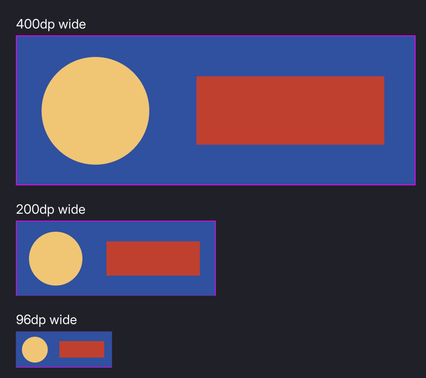

# Vector art

Icons from SVGs that stay crisp at any magnification, used in markup exactly like a raster sprite.



The SVGs are baked to the same kind of distance field the text uses, and `` and `decorator: image(icon_sword)` work as they do for a PNG.

```bash
./bin/win64/msdfbake.exe vector --in art/ui/vector --out UI/art --rcss UI/vectors.rcss --layers
```

That packs the SVGs' fields into an atlas and writes a `@spritesheet` block between markers in `UI/vectors.rcss`. Link that stylesheet.

## When

Use it for art that has to survive **extreme magnification**: a HUD icon that also appears on a full-screen map, a world-space surface the player can walk up to, a `transform: scale` animation.

Everything else stays raster. A vector sprite costs one draw per colour layer where a whole raster sheet costs one, and most icons are never seen at more than one size. See **[images](images.md)**.

## What a field can represent

**A distance field is coverage and nothing else.** One field is one silhouette.

**Multi-colour art becomes a stack of silhouettes**, one per fill colour, painted back to front. Still one atlas, at the cost of one draw per layer. Keep the colour count low.

**A stack needs its frame image.** Every layer is absolutely positioned, so the baker emits a `<name>_frame` sprite carrying the drawing's proportions, and a hidden `` on it gives the box a height:

```html
<div class="knight-stack" style="width: 240dp">
	
	
	
</div>
```

Set the width and let the frame find the height: an image element's intrinsic size is the only aspect ratio RCSS has.

A vector sprite scales uniformly or not at all, so `ninepatch` and `tiled-box` are invalid on a vector atlas.

**The vector sheet is declared `1x`.** No second resolution to author.

## Recolouring

Each layer is emitted with the colour the drawing used, as `image-color`. Override it and the art recolours:

```css
.knight_0-ink { image-color: #f0c674; }
.knight_1-ink { image-color: #1f1f28; }
```

That composes with themes, and can be repainted at runtime.

## Gradients

A gradient fill is baked to **colour** rather than to a field, onto a second sheet the baker writes alongside the atlas. The field still produces the edge, so the silhouette stays as crisp as any other vector layer; only the fill is a raster, and a gradient upscales almost invisibly.

A gradient layer is a sprite like any other, with no `image-color`.

| Affinity fill | |
|---|---|
| Linear | works |
| Radial | works |
| Elliptical | works (a radial with a non-uniform transform) |
| Conical | **outline only.** SVG has no conical gradient, and Affinity exports the fill as an embedded bitmap that the parser discards |
| Mesh | **outline only.** Same, and there is no mesh gradient in SVG to export to |
| Hatch | it is clipped geometry rather than a gradient, and bakes as flat layers |

The baker scans the source for paints it cannot carry and names each one with what to do instead:

```
msdfbake: warning: conical: art/conical.svg contains <image>
msdfbake:   an embedded bitmap. Affinity exports a conical or mesh gradient this way, because SVG
msdfbake:   has neither. Export that fill as a PNG and use it as a raster sprite.
msdfbake:   Gradients that do bake: linear, radial and elliptical.
```

The same check catches `<pattern>` fills, SVG `<filter>` effects, `<meshgradient>`, live `<text>` that was never converted to curves, and `<use>`, which the parser drops, so an instanced shape goes missing. Pass **`--strict`** to make any of them fail the run in a build.

## What the baker handles

- **`clip-path` is honoured.** nanosvg discards it, so the baker reads it from the SVG and intersects the geometry with Skia's path operations. A clip path's own shape is a stencil and is never drawn.
- **Strokes are outlined into area**, since a field has no notion of a line. Joins (miter with its limit, round, bevel) and caps (butt, round, square) are read from the SVG and honoured. A stroke costs its own layer, because it is its own colour.
- **Overlapping contours are resolved.** Art often draws a shape as several intersecting paths; a field would reconstruct a false edge through the overlap, so the baker unions them first.

## Baking is not automatic

**Re-run `msdfbake vector` after changing an SVG.** Nothing watches the source art. Then reopen the document or run `folio.ReloadTextures`; `uipreview` picks it up through its file watcher.

## Tuning the bake

| | |
|---|---|
| `--px-em` | Field resolution per em. Higher is more precise and costs atlas area quadratically. |
| `--px-range` | The field's width in texels. Raise it only to widen the reach of effects. |
| `--page` | Atlas page size. One page per sheet; a spill is an error, because one `@spritesheet` names one image. |
| `--layers` | Bake multi-colour art as a stack. Without it a drawing is one silhouette and extra fills are discarded with a warning. |

`msdfbake dump --in <atlas> --png out.png` writes the field out as an image, to check a bake looks like the drawing.

## If it looks wrong

**A multi-colour icon renders nothing.** The stack's layers are absolutely positioned and add nothing to the container's height, so without its frame image the container collapses. Add the hidden `` on `<name>_frame`, as in [what a field can represent](#what-a-field-can-represent).

**A vector stack squashes when the window aspect changes.** It is sized as a percentage of both width and height, which resolve against different bases. Set width or height, not both.

**A vector sprite has rounded corners and soft edges under `ninepatch` or `tiled-box`.** Non-uniform stretching corrupts the distance metric. Use a raster sprite for anything that stretches.

**A gradient layer comes out as a flat tint.** It has an `image-color`, which multiplies the gradient. Remove it from that layer.

**A conical or mesh fill bakes as an outline only.** Affinity exports those as an embedded bitmap, which the parser discards. The baker warns: `msdfbake: warning: conical: art/conical.svg contains <image>`. Export that fill as a PNG and use it as a raster sprite.

**A shape is missing from the bake.** `<use>` is dropped by the parser, so an instanced shape goes missing. The baker warns about it, along with `<pattern>`, SVG `<filter>`, `<meshgradient>` and live `<text>`. Expand the instance or convert the text to curves, and pass `--strict` to fail a build on any of them.

**A multi-colour drawing bakes as one flat silhouette.** It was baked without `--layers`. The baker says `msdfbake: warning: <name> has <n> fill colours, and one field holds one silhouette, so every filled path merges into a single shape`. Re-run with `--layers`.

**An edited SVG still shows the old art.** Nothing watches the source, and RmlUi caches a texture by its path. Re-run `msdfbake vector`, then reopen the document or run `folio.ReloadTextures`.

## Where to go next

- **[Images and sprites](images.md)**: the raster path, which is still the default.
- **[Text and fonts](text_and_fonts.md)**: the same fields, for glyphs.
- **[UI_CONVENTIONS.md](../UI_CONVENTIONS.md)** §7: the full reference.
